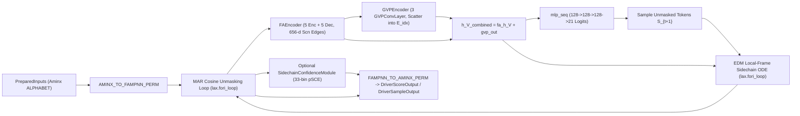

# FAMPNN (Tier 4 Full-Atom MPNN) Family Port Technical Specification

## Goal

Deliver a pure-JAX, `equinox.Module`-based, `L-DRV`-compliant port of **Full-Atom MPNN (`fampnn`, `richardshuai/fampnn`)** into `src/aminx/families/fampnn/` and register `family="fampnn"` on the `aminx` host execution and weight-loading surfaces (closing Praxia debt item **#3073**). The port supports all three official upstream weights (`fampnn_0_0.pt`, `fampnn_0_3.pt`, `fampnn_0_3_cath.pt`), comprising the 5-layer full-atom MPNN encoder-decoder (`FAEncoder`), the 3-layer Geometric Vector Perceptron graph encoder (`GVPEncoder`), the 21-way sequence classification head (`mlp_seq`), the 4-block AdaLN-Zero sidechain diffusion module (`SidechainDiffusionModule` with EDM ODE/churn stepping in the local backbone frame), the optional 3-layer sidechain confidence head (`SidechainConfidenceModule` predicting per-atom expected pSCE in Å), and the Masked Autoregressive (`MAR`) iterative joint sequence-and-sidechain unmasking schedule, with graded numerical parity (`float64 < 1e-6`, `float32 < 1e-4`) against the upstream PyTorch reference.

## Non-goals

- **Training or fine-tuning FAMPNN weights**: Neither masked cross-entropy sequence loss nor conditional flow-matching / EDM training losses (`fampnn/sampling/Loss.py`) nor PyTorch Lightning / Hydra training loops are ported.
- **Runtime dependencies on `rdkit`, `gemmi`, `openfold`, `torch_geometric`, `torch_scatter`, or `torch_cluster`**: All chemical reference coordinates (`RESTYPE_REF_POS_ATOM37`), Atom14/Atom37 index tables, rigid frame transforms (`backbone_coords_to_frames`, `transform_sidechain_frame`), and GVP message-passing primitives are implemented in pure JAX/NumPy inside `src/aminx/families/fampnn/` with zero external chemistry or graph-library dependencies at runtime.
- **Modifying core Tier-1 ProteinMPNN / SolubleMPNN / LigandMPNN modules**: [`src/aminx/model/encoder.py`](file:///home/marielle/projects/aminx/.claude/worktrees/261026-mpnn-variants/src/aminx/model/encoder.py), [`src/aminx/model/decoder.py`](file:///home/marielle/projects/aminx/.claude/worktrees/261026-mpnn-variants/src/aminx/model/decoder.py), and [`src/aminx/model/features.py`](file:///home/marielle/projects/aminx/.claude/worktrees/261026-mpnn-variants/src/aminx/model/features.py) are not altered to accommodate FAMPNN's edge-updating `DecLayer` or 656-dim `SidechainProteinFeatures`; FAMPNN modules reside under `src/aminx/families/fampnn/`.
- **Multi-GPU `pmap` or `shard_map` parallelism inside the family package**: Per [`tests/lint/test_l_drv.py`](file:///home/marielle/projects/aminx/.claude/worktrees/261026-mpnn-variants/tests/lint/test_l_drv.py) Rule R1, `vmap`, `pmap`, `filter_vmap`, and `shard_map` are strictly prohibited in `src/aminx/families/fampnn/`.

## Functional requirements

- FR-1: **Weight Registry, Checkpoint Inventory, and PyTorch-to-Equinox Conversion (`src/aminx/io/family_weights.json`, `src/aminx/io/weights.py`, `src/aminx/families/fampnn/convert.py`)** — Register `"fampnn"` in [`src/aminx/io/family_weights.json`](file:///home/marielle/projects/aminx/.claude/worktrees/261026-mpnn-variants/src/aminx/io/family_weights.json) and [`src/aminx/io/weights.py`](file:///home/marielle/projects/aminx/.claude/worktrees/261026-mpnn-variants/src/aminx/io/weights.py#L42-L585) (`FAMILY_NAMES`, `_FAMILY_VALIDATORS`, and `load_family_checkpoint`), and implement `src/aminx/families/fampnn/convert.py` to convert all three upstream checkpoints (`fampnn_0_0.pt` with 548 keys and `has_confidence=True`, `fampnn_0_3.pt` with 548 keys and `has_confidence=True`, and `fampnn_0_3_cath.pt` with 386 keys and `has_confidence=False`) into `.eqx` format and instantiate `FAMPNNModel` via `load_fampnn_model(checkpoint_path)` with strict key-set and tensor-shape validation.
- FR-2: **Frozen Chemical & Residue Lookup Constants (`src/aminx/families/fampnn/constants.py`)** — Provide a pure-NumPy/JAX constants module `src/aminx/families/fampnn/constants.py` that reproduces upstream `fampnn/data/residue_constants.py` and `fampnn/data/life.py` without importing `rdkit`, `gemmi`, or `openfold`, including the bijection permutations `FAMPNN_TO_AMINX_PERM` and `AMINX_TO_FAMPNN_PERM` between FAMPNN's AlphaFold 3-letter alphabetical order (`ARNDCQEGHILKMFPSTWYVX`, `fampnn/data/residue_constants.py:781-811`) and `aminx`'s canonical 1-letter order (`ACDEFGHIKLMNPQRSTVWYX`), Atom37/Atom14 index and mask tables (`RESTYPE_ATOM14_TO_ATOM37`, `RESTYPE_ATOM37_TO_ATOM14`, `RESTYPE_ATOM14_MASK_WITH_X`, `STANDARD_ATOM_MASK_WITH_X`, `NON_BB_IDXS`), and the static idealized sidechain reference coordinate table `RESTYPE_REF_POS_ATOM37` of shape `(21, 37, 3)` (`fampnn/data/life.py:572-622`).
- FR-3: **Full-Atom Coordinate Geometry, Frame Transforms, and Feature Extraction (`src/aminx/families/fampnn/features.py`)** — Implement pure-JAX geometry and feature modules in `src/aminx/families/fampnn/features.py` matching `fampnn/data/data.py` and `fampnn/model/fampnn.py:161-361`: `atom37_to_atom14` (`fampnn/data/data.py:316-348`) with `CA` coordinate replacement for masked Atom14 slots (`fampnn/model/fampnn.py:88`), `backbone_coords_to_frames` (`fampnn/data/data.py:521-546`), `transform_sidechain_frame` (`fampnn/data/data.py:548-579`), `get_rotation_frames` (`fampnn/data/data.py:480-493`), `FAMPNNProteinFeatures` (`edge_in = 16 + 16*25 = 416 -> 128`, `fampnn/model/fampnn.py:161-257`), and `SidechainProteinFeatures` (`edge_in = 16 + 16*4*10 = 656 -> 128`, `fampnn/model/fampnn.py:258-332`).
- FR-4: **Full-Atom MPNN Encoder-Decoder (`FAEncoder`, `EncLayer`, and Edge-Updating `DecLayer` in `src/aminx/families/fampnn/model.py`)** — Implement `FAEncoder`, `EncLayer` (`num_encoder_layers=5`, `hidden_dim=128`, `num_in=256`), and FAMPNN's edge-updating `DecLayer` (`num_decoder_layers=5`, `hidden_dim=128`, `num_in=512`, including the edge update MLP `W11 -> W12 -> W13 -> norm3` over `[h_V_expand, h_EV]` producing updated `(L, K, 512)` `h_ESV` features and exact `jax.nn.gelu(approximate=False)` activations) in `src/aminx/families/fampnn/model.py`, matching `fampnn/model/fampnn.py:14-159, 364-466`.
- FR-5: **Geometric Vector Perceptron Graph Encoder & Sequence Head (`GVPEncoder` and `mlp_seq` in `src/aminx/families/fampnn/gvp.py` and `model.py`)** — Implement `GVPEncoder`, `GVPGraphEmbedding` (node dim `(6, 15) -> (128, 16)` with virtual $C_\beta$ tetrahedral orientation fallback when `atom14_mask[:, 4] == 0`, edge dim `(32, 56) -> (32, 1)`, and linear MPNN node/edge feature injection), 3 `GVPConvLayer`s with PyTorch Geometric `flow="source_to_target"` scatter-mean aggregation into `dest = E_idx` (`fampnn/model/gvp/gvp_modules.py:207-211, 457-465`), local-frame vector output rotation `rotate_out=True` (`W_out: 176 -> 128`, `norm_gvp_out`), and the 3-layer `mlp_seq` (`128 -> 128 -> 128 -> 21` with ReLU) matching `fampnn/model/gvp/gvp_modules.py:44-592` and `fampnn/model/sd_model.py:42-159`.
- FR-6: **Sidechain Diffusion Head (`SidechainDiffusionModule`) and Optional Confidence Head (`SidechainConfidenceModule`) (`src/aminx/families/fampnn/sidechain_diffusion.py`)** — Implement `SidechainDiffusionModule` (`SidechainMLP` with `in_channels=219`, `hidden_size=256`, `TimestepEmbedder`, reference coordinate `f_embedder: 111 -> 256`, 4 AdaLN-Zero `DenoisingMLPBlock`s using `jax.nn.gelu(approximate=True)` and `LayerNorm(eps=1e-6, elementwise_affine=False)`, and `FinalLayer: 256 -> 99`) and the optional `SidechainConfidenceModule` (3-layer `ConfidenceEncoder` over `(fa_h_V, h_ESV)` plus `aatype_embedder`, `sidechain_encoder`, and `mlp: 128 -> 128 -> 1089` predicting expected per-atom pSCE over 33 bins in `[0.0, 8.0] Å`), matching `fampnn/model/sidechain_diffusion/scn_diffusion_mlp.py`, `dit_utils.py`, and `sidechain_confidence.py`.
- FR-7: **EDM Sidechain ODE Sampler & MAR Joint Unmasking Schedule (`src/aminx/families/fampnn/sidechain_diffusion.py`, `src/aminx/families/fampnn/driver.py`)** — Implement EDM preconditioned denoising (`sigma_data=1.0`, `sigma_min=0.004`, `sigma_max=80.0`, `rho=7.0`) and Euler/churn ODE integration in the local backbone frame (`fampnn/interpolants/edm_interpolant.py:55-248`) together with the MAR cosine-scheduled iterative joint sequence-and-sidechain unmasking loop (`fampnn/interpolants/mar_interpolant.py:12-162`, `fampnn/sampling/seq_design.py:72-182`) using `jax.lax.fori_loop`.
- FR-8: **`FAMPNNDriver` Protocol Integration & `L-DRV` Compliance (`src/aminx/families/fampnn/driver.py`, `src/aminx/run/specs.py`, `src/aminx/host/family_runner.py`, `tests/lint/l_drv_allowlist.toml`)** — Implement `FAMPNNDriver(FamilyDriver)` in `src/aminx/families/fampnn/driver.py` supporting `prepare_inputs`, `score`, and `sample` (with alphabet permutation at the driver boundary and full-atom coordinates + optional pSCE confidence returned in `extra`), register `"fampnn"` in [`src/aminx/run/specs.py`](file:///home/marielle/projects/aminx/.claude/worktrees/261026-mpnn-variants/src/aminx/run/specs.py#L26) and [`src/aminx/host/family_runner.py`](file:///home/marielle/projects/aminx/.claude/worktrees/261026-mpnn-variants/src/aminx/host/family_runner.py), and pass all `R1`–`R5` static lint rules in [`tests/lint/test_l_drv.py`](file:///home/marielle/projects/aminx/.claude/worktrees/261026-mpnn-variants/tests/lint/test_l_drv.py) with documented `sequential_dependency` allowlist entries in [`tests/lint/l_drv_allowlist.toml`](file:///home/marielle/projects/aminx/.claude/worktrees/261026-mpnn-variants/tests/lint/l_drv_allowlist.toml).

### Detailed Architecture & Design

#### 1. Checkpoint Inventory & Parameter Namespace Breakdown (`FR-1`)

All three upstream checkpoints (`fampnn_0_0.pt`, `fampnn_0_3.pt`, `fampnn_0_3_cath.pt`) instantiate `SeqDenoiser` (`fampnn/model/sd_model.py:19-69`) and store `{"state_dict": ..., "cfg": ...}`:

| Variant Name | Upstream Filename | Total Keys | `feature_extractor.fa_encoder.*` | `feature_extractor.gvp_encoder.*` | `mlp_seq.*` | `scn_diffusion_module.*` | `confidence_module.*` |
| :--- | :--- | :---: | :---: | :---: | :---: | :---: | :---: |
| `fampnn_0_0` | `fampnn_0_0.pt` | **548** | 169 | 98 | 6 | 113 | 162 (`has_confidence=True`) |
| `fampnn_0_3` | `fampnn_0_3.pt` | **548** | 169 | 98 | 6 | 113 | 162 (`has_confidence=True`) |
| `fampnn_0_3_cath` | `fampnn_0_3_cath.pt` | **386** | 169 | 98 | 6 | 113 | 0 (`has_confidence=False`) |

`src/aminx/families/fampnn/convert.py` inspects `ckpt["cfg"]` and `ckpt["state_dict"]` to extract exact structural dimensions (`num_encoder_layers`, `num_decoder_layers`, `hidden_dim`, `k_neighbors`, `scn_mlp.depth`, `has_confidence`) and records them in the `.eqx` header alongside converted `eqx.nn.Linear` / `eqx.nn.LayerNorm` / `eqx.nn.Embedding` weights.

#### 2. `FAEncoder` & Edge-Updating `DecLayer` (`FR-3`, `FR-4`)

- **Atom37 $\to$ Atom14 with `CA` Fallback (`fampnn/model/fampnn.py:86-88`)**:
  - `X, atom14_mask = atom37_to_atom14(aatype_noised, denoised_coords, atom37_mask=atom_mask_noised)`
  - `X = jnp.where(atom14_mask[..., None] == 0, X[..., 1:2, :], X)`
- **Backbone & Sidechain Edge Features (`fampnn/model/fampnn.py:91-139`)**:
  - `FAMPNNProteinFeatures` (`fampnn.py:161-257`): 16-d `PositionalEncodings` + 25 $\times$ 16-bin RBFs over `{Ca, N, C, O, Cb}` (`edge_in = 416`) $\to$ `edge_embedding(416 -> 128, bias=False)` $\to$ `norm_edges(128, eps=1e-5)` $\to$ `W_e(128 -> 128, bias=True)`.
  - 5 `EncLayer`s (`fampnn.py:420-466`) update `(h_V, h_E)` with `scale=30.0` and exact `jax.nn.gelu(x, approximate=False)`.
  - `SidechainProteinFeatures` (`fampnn.py:258-332`): 16-d `PositionalEncodings` + 40 $\times$ 16-bin RBFs pairing backbone `[Ca, N, C, O]` of residue $i$ against the 10 non-backbone Atom14 slots `4..13` of neighbor $j \in E_{\text{idx}}[i]$ (`edge_in = 656`) $\to$ `edge_embedding(656 -> 128, bias=False)` $\to$ `norm_edges(128, eps=1e-5)` $\to$ `W_e2(128 -> 128, bias=True)`.
  - Concatenate `h_ES = jnp.concatenate([h_E, h_S_neighbors, h_E2], axis=-1)` `(L, K, 384)`.
- **Edge-Updating `DecLayer` (`fampnn/model/fampnn.py:145-153, 364-418`)**:
  - Because `autoregressive=False`, `mask_bw = mask_attend` `(L, K, 1)` and `h_ESV = mask_bw * cat_neighbors_nodes(h_V, h_ES, E_idx)` `(L, K, 512)`.
  - Each `DecLayer` updates node features `h_V` via `W1(640 -> 128) -> GELU -> W2(128 -> 128) -> GELU -> W3(128 -> 128)`, `norm1(128)`, `dense(128 -> 512 -> 128)`, `norm2(128)`, and updates edge features `h_ESV` via `W11 -> GELU -> W12 -> GELU -> W13(128 -> 512)` and `norm3(512)`.

#### 3. `GVPEncoder` & PyG `source_to_target` Scatter Aggregation (`FR-5`)

- **`GVPGraphEmbedding` (`fampnn/model/gvp/gvp_modules.py:106-261`)**:
  - Node scalars `(L, 6)`: `dihedrals(X[:, :3, :])`.
  - Node vectors `(L, 15, 3)`: `ca_orientations` `(L, 2, 3)` + `fa_orientations` `(L, 13, 3)`, overwriting `fa_orientations[:, 3, :]` (Atom14 slot 4 = $C_\beta$) with `sidechains(X[:, :4, :])` whenever `(atom14_mask[:, 4] == 0) & (~padding_mask)` (`gvp_modules.py:176-180`).
  - Edge scalars `(L, K, 32)`: 16-bin $C_\alpha$ RBF `[0, 20] Å` + 16-d sinusoidal positional embedding, masked by `E_residue_mask = (D_neighbors < 5e9)`.
  - Edge vectors `(L, K, 56, 3)`: normalized displacement vectors from `[X_ca, X_n, X_c, X_o]` of residue $u$ to all 14 Atom14 atoms of neighbor $v = E_{\text{idx}}[u, k]$.
  - Injects `embed_mpnn_node(h_V)` (`128 -> 128`) into node scalars and `embed_mpnn_edge(h_ESV)` (`512 -> 32`) into edge scalars after `GVPLayerNorm(eps=1e-4)`.
- **PyG `source_to_target` Scatter-Mean into `E_idx` (`gvp_modules.py:207-218, 457-467`)**:
  - For each edge $(u, k)$ with $v = E_{\text{idx}}[u, k]$:
    $$\text{msg}_{u,k} = \text{GVP}_{\text{msg}}^3\big(\text{tuple\_cat}((s_u, v_u), e_{u,k}, (s_v, v_v))\big)$$
  - Masked by `valid_edge = E_residue_mask[u, k] & (~padding_mask[u])`, messages are scatter-summed into target node index $v = E_{\text{idx}}[u, k]$ via `.at[E_idx].add(...)` and divided by `jnp.maximum(in_degree[v], 1.0)`.
- **Output Frame Rotation (`gvp_modules.py:93-104`)**:
  - Rotate `gvp_out_vectors` `(L, 16, 3)` by `R = get_rotation_frames(X[:, :3, :])`, flatten to `(L, 48)`, concatenate with `gvp_out_scalars` `(L, 128)` to `(L, 176)`, project via `W_out(176 -> 128)`, and add to `fa_h_V`.

#### 4. `SidechainDiffusionModule`, `SidechainConfidenceModule`, and EDM/MAR Samplers (`FR-6`, `FR-7`, `FR-8`)

#### 5. Graded Parity Test Matrix (`tests/families/test_fampnn_parity.py`)

| Stage | Submodule Under Test | Reference Target | `float64` Gate | `float32` Gate | Negative Control |
| :---: | :--- | :--- | :---: | :---: | :--- |
| 1 | `constants.py` & `features.py` | `atom37_to_atom14`, `backbone_coords_to_frames`, `transform_sidechain_frame`, `get_rotation_frames`, `RESTYPE_REF_POS_ATOM37` | `< 1e-6` | `< 1e-5` | Round-trip `transform_sidechain_frame(to_local=True -> False)` recovers coords; corrupting `aatype` changes Atom14 gather |
| 2 | `FAMPNNProteinFeatures` & `SidechainProteinFeatures` | `fampnn.model.fampnn.ProteinFeatures` (`416 -> 128`) & `SidechainProteinFeatures` (`656 -> 128`) | `< 1e-6` | `< 1e-4` | Masking sidechain atoms (`atom14_mask[:, 4:] = 0`) changes `E_scn` while leaving backbone `E` invariant |
| 3 | `FAEncoder` (`EncLayer` $\times 5$, `DecLayer` $\times 5$) | `fampnn.model.fampnn.FAEncoder.forward` (`h_V`, `h_ESV`, `E_idx`, `D_neighbors`) | `< 1e-6` | `< 1e-4` | Perturbing `aatype_noised` or `atom_mask_noised` alters `h_V` and `h_ESV` (`max_abs_diff > 1e-2`) |
| 4 | `GVPEncoder` & `mlp_seq` | `fampnn.model.gvp.gvp_modules.GVPEncoder.forward` & `SeqDenoiser.mlp_seq` | `< 1e-6` | `< 1e-4` | Replacing PyG scatter-mean into `E_idx` with naive source-mean fails parity (`max_abs_diff > 1e-1`); global SE(3) rotation leaves `gvp_out` invariant |
| 5 | `SidechainDiffusionModule` & `SidechainConfidenceModule` | `SidechainDiffusionModule.forward_with_preconditioning` & `SidechainConfidenceModule.forward` | `< 1e-6` | `< 1e-4` | Zeroing `x_sc` self-conditioning or changing timestep $\sigma$ shifts denoised sidechain coordinates |
| 6 | Deterministic EDM ODE, MAR Step, & `FAMPNNDriver` | `EDM.sample(churn=0.0)` & `FAMPNNDriver.score` / `FAMPNNDriver.sample` | `< 1e-6` | `< 1e-4` | Unpermuted alphabet fails canonical `aminx` logit alignment test |

## Acceptance

- [FR-1] `uv run pytest tests/families/test_fampnn_parity.py -k "test_fampnn_convert_and_weights" -q`
- [FR-2] `uv run pytest tests/families/test_fampnn_parity.py -k "test_fampnn_constants" -q`
- [FR-3] `uv run pytest tests/families/test_fampnn_parity.py -k "test_fampnn_features_and_frames" -q`
- [FR-4] `uv run pytest tests/families/test_fampnn_parity.py -k "test_fampnn_fa_encoder_parity" -q`
- [FR-5] `uv run pytest tests/families/test_fampnn_parity.py -k "test_fampnn_gvp_encoder_and_seq_logits_parity" -q`
- [FR-6] `uv run pytest tests/families/test_fampnn_parity.py -k "test_fampnn_sidechain_mlp_and_confidence_parity" -q`
- [FR-7] `uv run pytest tests/families/test_fampnn_parity.py -k "test_fampnn_edm_and_mar_sampling_parity" -q`
- [FR-8] `uv run pytest tests/lint/test_l_drv.py tests/families/test_fampnn_parity.py -k "test_l_drv or test_fampnn_driver_end_to_end" -q`

## Assumptions

| Assumption | Owner | Verification method |
| :--- | :--- | :--- |
| Upstream checkpoints `fampnn_0_0.pt`, `fampnn_0_3.pt`, and `fampnn_0_3_cath.pt` store the exact `RESTYPE_REF_POS_ATOM37` `(21, 37, 3)` buffer under `scn_diffusion_module.aatype_to_Atom37_ref_pos`, allowing `constants.py` and `convert.py` to verify bit-exact reference coordinates without `rdkit` or `gemmi`. | Spec Author / Implementer | Unit test in `tests/families/test_fampnn_parity.py` asserting `jnp.array_equal(RESTYPE_REF_POS_ATOM37, ckpt_ref_pos)`. |
| `protein.full_coordinates` `(L, 37, 3)` and `protein.full_atom_mask` `(L, 37)` are populated by `proxide` when full-atom structures are loaded, and `FAMPNNDriver.prepare_inputs` can safely fall back to backbone slots `[0, 1, 2, 4]` from `protein.coordinates` `(L, 4, 3)` when sidechain atoms are absent or masked for sequence design. | Implementer | Unit test in `tests/families/test_fampnn_parity.py` testing `FAMPNNDriver.prepare_inputs` on both full-atom and backbone-only `Protein` structures. |
| All `L-DRV` static AST lint checks (`R1`–`R5` in `tests/lint/test_l_drv.py`) pass when `edm_sample` and `mar_sample` `jax.lax.fori_loop` sites are registered in `tests/lint/l_drv_allowlist.toml` with `reason = "sequential_dependency"`. | Implementer | Run `uv run pytest tests/lint/test_l_drv.py -q`. |

## Prior art

- **In-repo `FamilyDriver` & Alphabet Permutation Pattern (`src/aminx/families/laser_mpnn/driver.py:84-120`, `src/aminx/host/family_driver.py:124-186`)**: [`LASErMPNNDriver`](file:///home/marielle/projects/aminx/.claude/worktrees/261026-mpnn-variants/src/aminx/families/laser_mpnn/driver.py#L84-L120) establishes the exact pattern for mapping between a family's internal residue ordering and `aminx`'s canonical `ALPHABET = "ACDEFGHIKLMNPQRSTVWYX"` at the driver boundary (`prepare_inputs`, `score`, `sample`), while keeping internal model weights in their native checkpoint ordering so weight tensors require no row-slicing permutations during conversion.
- **In-repo Weight Conversion & Validation Pattern (`src/aminx/families/thermo_mpnn/convert.py`, `src/aminx/io/weights.py:553-611`)**: [`ThermoMPNN`](file:///home/marielle/projects/aminx/.claude/worktrees/261026-mpnn-variants/src/aminx/families/thermo_mpnn/convert.py#L1-L120) and [`PottsMPNN`](file:///home/marielle/projects/aminx/.claude/worktrees/261026-mpnn-variants/src/aminx/families/potts_mpnn/driver.py#L1-L120) establish the two-stage validation contract: a structural validator in [`src/aminx/io/weights.py`](file:///home/marielle/projects/aminx/.claude/worktrees/261026-mpnn-variants/src/aminx/io/weights.py#L553-L611) (`_FAMILY_VALIDATORS["fampnn"]`) verifying top-level `.eqx` subtree presence and leaf finite/shape checks, paired with a deterministic PyTorch-to-Equinox converter in `src/aminx/families/fampnn/convert.py`.
- **In-repo `L-DRV` Allowlist Precedent (`tests/lint/test_l_drv.py`, `tests/lint/l_drv_allowlist.toml`)**: [`tests/lint/test_l_drv.py`](file:///home/marielle/projects/aminx/.claude/worktrees/261026-mpnn-variants/tests/lint/test_l_drv.py#L1-L120) and [`tests/lint/l_drv_allowlist.toml`](file:///home/marielle/projects/aminx/.claude/worktrees/261026-mpnn-variants/tests/lint/l_drv_allowlist.toml#L1-L104) register sequential decoding/sampling `lax.fori_loop` / `lax.scan` sites with `reason = "sequential_dependency"`, while keeping all `eqx.Module.__call__` layer iterations strictly over `self.<layers>`.
- **Upstream Reference Implementation (`richardshuai/fampnn`, ICML 2025 / bioRxiv 2025)**: Full-Atom Protein Sequence Design with Continuous Sidechain Diffusion (`fampnn/model/fampnn.py`, `fampnn/model/gvp/gvp_modules.py`, `fampnn/model/sidechain_diffusion/scn_diffusion_mlp.py`, `fampnn/model/sidechain_diffusion/sidechain_confidence.py`, `fampnn/interpolants/edm_interpolant.py`, `fampnn/interpolants/mar_interpolant.py`).

Queries:
- `rg "FamilyDriver|DriverScoreOutput|DriverSampleOutput" src/aminx/`
- `rg "L-DRV|sequential_dependency" tests/lint/`
- `rg "AMINX_TO_|_PERM" src/aminx/families/`
- `search_web("richardshuai/fampnn Full-Atom MPNN sidechain diffusion")`

## Risks

### Adversarial Spec Challenge & Resolution Record (Challenger vs. Defender)

1. **Hazard 1 — PyTorch Geometric `flow="source_to_target"` Scatter Aggregation in `GVPEncoder`**:
   - **Challenger**: In `fampnn/model/gvp/gvp_modules.py:207-211`, `edge_index = torch.stack([src, dest], dim=0)` where `src = arange(L)` and `dest = E_idx`. A naive JAX port of `GVPConv` would compute messages on `(L, K, ...)` and take `jnp.mean(messages, axis=1)` over the $K$ outgoing kNN edges of node $i$. However, PyG `MessagePassing` defaults to `flow="source_to_target"`, which means `edge_index[0] = src` is passed as `_j` (`(s_j, v_j)` in `GVPConv.message`) and `edge_index[1] = dest = E_idx` is passed as `_i` (`(s_i, v_i)` in `GVPConv.message`) **and** used as the scatter index for `aggr="mean"`. Since kNN graphs are directed and asymmetric, aggregating over `axis=1` (`src`) instead of scatter-averaging into `dest = E_idx` produces wrong node updates and fails parity on every layer of `GVPEncoder`.
   - **Defender Resolution**: Codified in `FR-5`. In `src/aminx/families/fampnn/gvp.py`, for every directed edge `(u, k)` with neighbor $v = E_{\text{idx}}[u, k]$, `message = tuple_cat((s[u], v[u]), edge_attr[u, k], (s[v], v[v]))`, masked by `valid_edge = E_residue_mask[u, k] & (~padding_mask[u])`. Aggregation uses `jnp.zeros_like(s).at[E_idx].add(masked_msg_s)` (and identically for vector channels) divided by `jnp.maximum(jnp.zeros((L, 1)).at[E_idx].add(valid_edge[..., None].astype(s.dtype)), 1.0)`.

2. **Hazard 2 — Checkpoint Hyperparameter & Sub-Variant Differences (`fampnn_0_3_cath.pt` Lacks `confidence_module`)**:
   - **Challenger**: Upstream `fampnn` stores the training Hydra `cfg` dict directly inside each `.pt` checkpoint (`ckpt["cfg"]` alongside `ckpt["state_dict"]`, loaded at `fampnn/model/fampnn_denoiser.py:42-48`), and `fampnn_0_3_cath.pt` has 386 keys (`confidence_module: None`) whereas `fampnn_0_0.pt` and `fampnn_0_3.pt` have 548 keys (including 162 `confidence_module.*` keys). Hardcoding layer counts from `configs/seq_design.yaml` or unconditionally requiring `confidence_module.*` will fail to load `fampnn_0_3_cath.pt`.
   - **Defender Resolution**: Codified in `FR-1` and `FR-6`. `FAMPNNModel.confidence_module` is typed as `SidechainConfidenceModule | None`, and `src/aminx/families/fampnn/convert.py` infers layer counts and `has_confidence` directly from `ckpt["cfg"]` and `ckpt["state_dict"]` shapes, serializing them into the `.eqx` header.

3. **Hazard 3 — Amino-Acid Alphabet Ordering Mismatch (`ARNDCQEGHILKMFPSTWYVX` vs `ACDEFGHIKLMNPQRSTVWYX`)**:
   - **Challenger**: Upstream FAMPNN indexes residues using AlphaFold's `rc.restypes_with_x` (`ARNDCQEGHILKMFPSTWYVX`, `fampnn/data/residue_constants.py:781-811`), whereas `aminx` represents all sequences, `PreparedInputs`, `DriverScoreOutput.logits`, and `DriverSampleOutput.S` in canonical 1-letter alphabetical order (`ACDEFGHIKLMNPQRSTVWYX`). Failing to permute both input `aatype` and output `S`/`logits` at the `FAMPNNDriver` boundary will silently corrupt all non-`A`/`C`/`V`/`W`/`Y`/`X` amino acid conditioning, Atom14 lookup tables, `RESTYPE_REF_POS_ATOM37` lookups, and output log-probabilities.
   - **Defender Resolution**: Codified in `FR-2` and `FR-8`. `FAMPNNDriver.prepare_inputs` maps `aminx` indices into FAMPNN order via `AMINX_TO_FAMPNN_PERM` before running `FAEncoder`/`GVPEncoder`/`SidechainDiffusionModule`, and `FAMPNNDriver.score` / `FAMPNNDriver.sample` permute output logits (`logits[..., FAMPNN_TO_AMINX_PERM]`) and sampled token indices (`FAMPNN_TO_AMINX_PERM[S]`) back into `aminx` canonical order before returning.

4. **Hazard 4 — Runtime Chemistry Library Dependency in `fampnn/data/life.py` (`rdkit` + `gemmi` + `openfold`)**:
   - **Challenger**: Upstream `fampnn/data/life.py:219-622` parses 20 CCD `.cif` files using `gemmi` and `rdkit.Chem` at module import time to build `RESTYPE_REF_POS_ATOM37` (`(21, 37, 3)`), and `fampnn/data/data.py:13` imports `openfold.np.protein`. Importing any of these in `aminx` would violate `aminx`'s pure-JAX dependency policy.
   - **Defender Resolution**: Codified in `FR-2`. `RESTYPE_REF_POS_ATOM37` `(21, 37, 3)` is pre-extracted as a static `float32` constant array in `src/aminx/families/fampnn/constants.py` and verified against the checkpoint buffer `scn_diffusion_module.aatype_to_Atom37_ref_pos` stored inside `fampnn_*.pt`.

5. **Hazard 5 — Mixed GELU Formulations (`exact` vs `tanh` approximation) and LayerNorm Epsilons (`1e-5` vs `1e-4` vs `1e-6`)**:
   - **Challenger**: FAMPNN mixes three distinct `LayerNorm` epsilons and two `GELU` formulations across submodules: `FAEncoder` uses `nn.GELU(approximate='none')` and `eps=1e-5`; `GVPEncoder` uses `eps=1e-4` on `GVPLayerNorm` (both scalar LayerNorm and vector RMS norm) and `eps=1e-5` on `norm_gvp_out`; `SidechainMLP` uses `nn.GELU(approximate='tanh')` and parameterless `LayerNorm(eps=1e-6)`. Using JAX's default `jax.nn.gelu` (`approximate=True`) in `FAEncoder` causes `float32` parity drift of $\sim 2 \times 10^{-4}$ per layer and fails the `float64 < 1e-6` gate.
   - **Defender Resolution**: Codified in `FR-4`, `FR-5`, and `FR-6`. `FAEncoder` explicitly calls `jax.nn.gelu(x, approximate=False)` with `eps=1e-5`; `GVPLayerNorm` uses `eps=1e-4`; `SidechainMLP` calls `jax.nn.gelu(x, approximate=True)` with `eps=1e-6`.

6. **Hazard 6 — Missing-$C_\beta$ Virtual Tetrahedral Fallback in `GVPGraphEmbedding` vs Atom14 `CA` Replacement in `FAEncoder`**:
   - **Challenger**: In `FAEncoder.forward` (`fampnn/model/fampnn.py:88`), missing Atom14 slots (`atom14_mask == 0`, including slot 4 = $C_\beta$ for Glycine or sequence-masked residues) are replaced with `CA` (`X[..., 1:2, :]`). When `X` is then passed into `GVPEncoder` (`gvp_modules.py:173-180`), `fa_orientations = normalize(X[:, i != 1] - X_ca)` yields a zero vector at index 3 (Atom14 slot 4 = $C_\beta$) wherever `atom14_mask[:, 4] == 0`. Upstream then explicitly overwrites `fa_orientations[:, :, 3]` where `(atom14_mask[:, :, 4] == 0) & (~padding_mask)` with `cb_orientations = sidechains(X[:, :4, :])` (the tetrahedral bisector orientation computed from `N, CA, C`). Omitting this overwrite breaks `GVPEncoder` parity on all masked/Glycine residues.
   - **Defender Resolution**: Codified in `FR-5`. `GVPGraphEmbedding` computes `cb_orientations = sidechains(X[:, :4, :])` (`(L, 3)`) and replaces `fa_orientations[:, 3, :]` via `jnp.where(((atom14_mask[:, 4] == 0) & (~padding_mask))[:, None], cb_orientations, fa_orientations[:, 3, :])`.

7. **Hazard 7 — `L-DRV` Static Lint Violations (R1 `vmap` Ban, R2 Loop Ban, R3 Allowlist)**:
   - **Challenger**: [`tests/lint/test_l_drv.py`](file:///home/marielle/projects/aminx/.claude/worktrees/261026-mpnn-variants/tests/lint/test_l_drv.py) scans all files under `src/aminx/families/`. Using `jax.vmap` violates Rule R1; writing Python `for` loops over atom pairs (`range(25)`, `range(40)`) or diffusion steps inside `eqx.Module.__call__` violates Rule R2; using `jax.lax.fori_loop` without an entry in `tests/lint/l_drv_allowlist.toml` violates Rule R3.
   - **Defender Resolution**: Codified in `FR-3`, `FR-7`, and `FR-8`. All linear, LayerNorm, RBF, and frame operations use native trailing-axis broadcasting (`x @ w.T + b`, `jnp.einsum`, `X_bb[:, None, :, None, :] - X_neighbors[:, :, None, :, :]`); `eqx.Module.__call__` loops iterate strictly over `self.<layer_tuple>`; and the two sequential sampling loops (`edm_sample` in `src/aminx/families/fampnn/sidechain_diffusion.py` and `mar_sample` in `src/aminx/families/fampnn/driver.py`) use `jax.lax.fori_loop` with documented `sequential_dependency` entries in `tests/lint/l_drv_allowlist.toml`.

