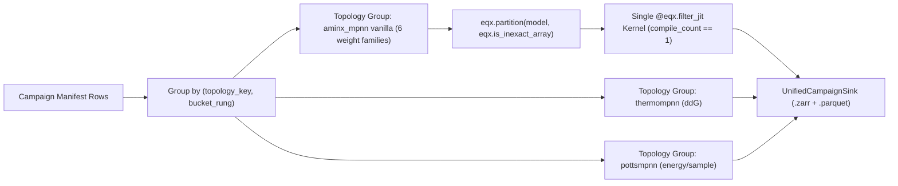

# Multi-Backend Campaign Arms, Topology-Grouped Dynamic Weight Hoisting, and Unified Campaign Sinks

## Goal

Resolve Praxia debt item **#3078** (`[campaign/sinks] Support multi-backend campaign arms with minimal JIT recompilations and unified, examinable sink storage`) in `/home/marielle/projects/aminx/.claude/worktrees/261026-mpnn-variants` by:
1. Extending [`plan_campaign_manifest`](file:///home/marielle/projects/aminx/.claude/worktrees/261026-mpnn-variants/src/aminx/host/campaign.py#L1126-L1330), [`write_campaign_manifest`](file:///home/marielle/projects/aminx/.claude/worktrees/261026-mpnn-variants/src/aminx/host/campaign.py#L1333-L1377), and [`build_manifest_row`](file:///home/marielle/projects/aminx/.claude/worktrees/261026-mpnn-variants/src/aminx/host/campaign.py#L72-L155) to accept an optional `backends` sequence spanning core MPNN weight families (`original`, `soluble`, `abmpnn`, `hypermpnn`, `cyclicmpnn`, `antibmpnn`, `ca_only`, `ligandmpnn`, `membrane`) and driver-backed families (`pottsmpnn`, `protonpottsmpnn`, `lasermpnn`, `thermompnn`, `caliby`, `fampnn`), while preserving 100% byte-for-byte manifest hash compatibility when `backends is None`.
2. Grouping campaign execution in [`run_campaign_manifest`](file:///home/marielle/projects/aminx/.claude/worktrees/261026-mpnn-variants/src/aminx/host/campaign.py) by `(topology_key, bucket_rung)` and hoisting Equinox weights as dynamic PyTree arguments via `eqx.partition(model, eqx.is_inexact_array)` / `eqx.combine(params_dyn, model_static)` inside `@eqx.filter_jit` so all 6 vanilla-topology weight families compile **exactly once** (`compile_count == 1`) per bucket rung.
3. Introducing `UnifiedCampaignSink` and `inspect_campaign_sink` in `src/aminx/io/campaign_sink.py` (with `"campaign_sink_v1": "1.0.0"` in [`src/aminx/host/schema_versions.py`](file:///home/marielle/projects/aminx/.claude/worktrees/261026-mpnn-variants/src/aminx/host/schema_versions.py#L1-L49)) to consolidate heterogeneous per-row outputs into `<campaign_dir>/campaign_sink.zarr` and `<campaign_dir>/campaign_summary.parquet` (with JSONL/CSV fallback).

## Non-goals

- Modifying existing single-backend `manifest_row_hash` values or breaking golden tests in [`tests/host/test_comp536_campaign_manifest.py`](file:///home/marielle/projects/aminx/.claude/worktrees/261026-mpnn-variants/tests/host/test_comp536_campaign_manifest.py#L97-L239) and [`tests/host/test_campaign_stamp_v3.py`](file:///home/marielle/projects/aminx/.claude/worktrees/261026-mpnn-variants/tests/host/test_campaign_stamp_v3.py#L1-L120) when `backends is None`.
- Merging architecturally incompatible graph topologies (e.g., `ThermoMPNN` 1D light-attention trunk vs. `PottsMPNN` Potts edge coupling head vs. `LigandMPNN` atom-context graph) into a single XLA HLO module; each distinct `TopologyKey` compiles once per `(topology_key, bucket_rung)`.
- Supporting multi-state Product-of-Experts (`multi_state_strategy="product_of_experts"`) or `grid_mode=True` on non-generative scoring-only driver families (`thermompnn`).
- Removing per-row `.done.json` crash-recovery markers or breaking existing `evaluate_campaign_gates` workflows.

## Functional requirements

- FR-1: **Backward-Compatible Single-Backend Campaign Manifests (`backends=None`)** — When `backends is None` in [`plan_campaign_manifest`](file:///home/marielle/projects/aminx/.claude/worktrees/261026-mpnn-variants/src/aminx/host/campaign.py#L1126-L1330) or [`write_campaign_manifest`](file:///home/marielle/projects/aminx/.claude/worktrees/261026-mpnn-variants/src/aminx/host/campaign.py#L1333-L1377) (and `declared_backend is None` in [`build_manifest_row`](file:///home/marielle/projects/aminx/.claude/worktrees/261026-mpnn-variants/src/aminx/host/campaign.py#L72-L155)), `hash_payload` keys, `row_id` strings, and `manifest_row_hash` SHA-256 digests remain 100% byte-for-byte identical to existing manifests.
- FR-2: **Multi-Backend Campaign Arm Planning (`BackendArmSpec` & `backends`)** — [`plan_campaign_manifest`](file:///home/marielle/projects/aminx/.claude/worktrees/261026-mpnn-variants/src/aminx/host/campaign.py#L1126-L1330) and [`write_campaign_manifest`](file:///home/marielle/projects/aminx/.claude/worktrees/261026-mpnn-variants/src/aminx/host/campaign.py#L1333-L1377) accept `backends: Sequence[str | Mapping[str, Any] | RunSpecification] | None = None`, normalize each entry via `normalize_backend_arm` into `BackendArmSpec(backend_id, model_family, model_weights, checkpoint_id, ca_only, ligand_mpnn_use_side_chain_context, purpose, topology_key)`, include backend identity in `hash_payload` when `backends is not None`, and prune redundant `(ligand_on=True, sidechain_on=True)` Cartesian cells on non-ligand backends.
- FR-3: **Driver-Backed Family Registration & Campaign Mode Support** — Register `"thermompnn"`, `"caliby"`, and `"fampnn"` alongside `"pottsmpnn"`, `"protonpottsmpnn"`, and `"lasermpnn"` in [`DRIVER_BACKED_FAMILY_MODULES`](file:///home/marielle/projects/aminx/.claude/worktrees/261026-mpnn-variants/src/aminx/host/family_driver.py#L33-L37) and [`ModelFamily`](file:///home/marielle/projects/aminx/.claude/worktrees/261026-mpnn-variants/src/aminx/host/family_driver.py#L30); replace blanket `refuse_driver_family(..., surface="campaign")` ([`campaign.py:L110, L1578`](file:///home/marielle/projects/aminx/.claude/worktrees/261026-mpnn-variants/src/aminx/host/campaign.py#L110)) and `_refuse_driver_modes` `campaign_mode` refusal ([`family_runner.py:L139-L150`](file:///home/marielle/projects/aminx/.claude/worktrees/261026-mpnn-variants/src/aminx/host/family_runner.py#L139-L150)) with capability-aware validation; and update [`_checkpoint_identity`](file:///home/marielle/projects/aminx/.claude/worktrees/261026-mpnn-variants/src/aminx/host/campaign.py#L652-L692) to resolve `family_checkpoints()` via `resolve_family_checkpoint` while obeying all `R1`–`R5` lint rules in [`tests/lint/test_l_drv.py`](file:///home/marielle/projects/aminx/.claude/worktrees/261026-mpnn-variants/tests/lint/test_l_drv.py#L1-L120).
- FR-4: **Topology-Grouped Execution & Dynamic Weight Hoisting (`compile_count == 1`)** — Define `TopologyKey` in [`src/aminx/host/plan.py`](file:///home/marielle/projects/aminx/.claude/worktrees/261026-mpnn-variants/src/aminx/host/plan.py) and implement `run_campaign_manifest` / `CampaignExecutor` in [`src/aminx/host/campaign.py`](file:///home/marielle/projects/aminx/.claude/worktrees/261026-mpnn-variants/src/aminx/host/campaign.py) that groups pending rows by `(topology_key, bucket_rung)`, partitions Equinox models via `params_dyn, model_static = eqx.partition(model, eqx.is_inexact_array)`, and passes `params_dyn` as a dynamic PyTree argument to a single cached `@eqx.filter_jit` topology kernel (`model = eqx.combine(params_dyn, model_static)` inside the jitted body) so all 6 vanilla weight families (`original`, `soluble`, `abmpnn`, `hypermpnn`, `cyclicmpnn`, `antibmpnn`) compile once (`compile_count_by_topology[vanilla_topology_key] == 1`) while producing numerically distinct per-checkpoint outputs.
- FR-5: **Unified Campaign Sink (`UnifiedCampaignSink` & `campaign_sink_v1`)** — Register `"campaign_sink_v1": "1.0.0"` in `SCHEMA_VERSIONS` inside [`src/aminx/host/schema_versions.py`](file:///home/marielle/projects/aminx/.claude/worktrees/261026-mpnn-variants/src/aminx/host/schema_versions.py#L1-L49) and implement `UnifiedCampaignSink` in `src/aminx/io/campaign_sink.py` writing `<campaign_dir>/campaign_sink.zarr` (with root metadata/provenance and `/rows/<row_id>/` standard + `aux/<key>` datasets for `ddg`, `h`, `J`, `energy`, `sidechain_coords`, `psce`) plus `<campaign_dir>/campaign_summary.parquet` (with automatic `.jsonl`/`.csv` fallback when `pyarrow` is absent).
- FR-6: **Examinable Sink Inspection & Crash-Only Idempotent Resume (`inspect_campaign_sink`)** — Provide `inspect_campaign_sink(path) -> CampaignSinkInspector` (re-exported from `aminx.io` and `aminx.host`) with `.summary_rows()`, `.list_backends()`, `.list_arms()`, `.get_row(row_id)`, and `.compare_backends(...)`, and guarantee crash-only idempotent resume where completed `.done.json` rows skip device execution and backfill into `UnifiedCampaignSink` if needed.

### Detailed Architecture & Design

#### 1. `BackendArmSpec` & Multi-Backend Planning (`FR-1`, `FR-2`, `FR-3`)

```python
@dataclass(frozen=True)
class BackendArmSpec:
    backend_id: str
    model_family: str
    model_weights: str
    checkpoint_id: str | None
    ca_only: bool
    ligand_mpnn_use_side_chain_context: bool
    purpose: str  # "sample", "score:ddg", "score:energy", "score:nll", "score:logits"
    topology_key: str
```

- When `backends is None` in `plan_campaign_manifest` / `write_campaign_manifest`:
  - `declared_backend` is `None` in `build_manifest_row`.
  - `hash_payload` and emitted manifest row dicts are untouched, preserving 100% compatibility with `tests/host/test_comp536_campaign_manifest.py` and `tests/host/test_campaign_stamp_v3.py`.
- When `backends is not None`:
  - `normalize_backend_arm` resolves shorthand strings (`"original"`, `"soluble"`, `"abmpnn"`, `"hypermpnn"`, `"cyclicmpnn"`, `"antibmpnn"`, `"ca_only"`, `"ligandmpnn"`, `"membrane"`, `"pottsmpnn"`, `"protonpottsmpnn"`, `"lasermpnn"`, `"thermompnn"`, `"caliby"`, `"fampnn"`, or explicit `checkpoint_id`), mappings, or `RunSpecification` instances.
  - `hash_payload` includes `backend_id`, `model_weights`, `checkpoint_id`, `ca_only`, `purpose`, and `topology_key`.
  - `DRIVER_BACKED_FAMILY_MODULES` in [`src/aminx/host/family_driver.py`](file:///home/marielle/projects/aminx/.claude/worktrees/261026-mpnn-variants/src/aminx/host/family_driver.py#L33-L37) registers all 6 driver-backed families (`pottsmpnn`, `protonpottsmpnn`, `lasermpnn`, `thermompnn`, `caliby`, `fampnn`).
  - `_checkpoint_identity` in [`src/aminx/host/campaign.py`](file:///home/marielle/projects/aminx/.claude/worktrees/261026-mpnn-variants/src/aminx/host/campaign.py#L652-L692) checks `if checkpoint_id in family_checkpoints():` before `weight_provenance(checkpoint_id)`.

#### 2. `TopologyKey` & `eqx.partition` Dynamic Weight Hoisting (`FR-4`)

```python
@dataclass(frozen=True)
class TopologyKey:
    model_family: str
    model_type: str               # "aminx_mpnn", "ligand_mpnn", "potts_mpnn", "thermo_mpnn", etc.
    ca_only: bool
    k_neighbors: int
    num_positional_embeddings: int
    node_features: int
    edge_features: int
    hidden_features: int
    num_encoder_layers: int
    num_decoder_layers: int
    vocab_size: int
    physics_feature_dim: int
    use_side_chain_context: bool
    decode_strategy: str
```

- For each checkpoint within a `(topology_key, bucket_rung)` execution group:
  ```python
  params_dyn, model_static = eqx.partition(model, eqx.is_inexact_array)
  ```
- `_compiled_topology_step(params_dyn, model_static, batch_tensors, rng_key, runtime_params)` is decorated with `@eqx.filter_jit` and calls `model = eqx.combine(params_dyn, model_static)` inside the jitted body.
- All 6 vanilla weight families share identical `model_static` and identical `params_dyn` leaf shapes/dtypes, resulting in `compile_count == 1` across all 6 checkpoints at a given bucket rung.



#### 3. `UnifiedCampaignSink` & `CampaignSinkInspector` (`FR-5`, `FR-6`)

- `SCHEMA_VERSIONS["campaign_sink_v1"] == "1.0.0"` in [`src/aminx/host/schema_versions.py`](file:///home/marielle/projects/aminx/.claude/worktrees/261026-mpnn-variants/src/aminx/host/schema_versions.py#L1-L49).
- Consolidated Zarr store `<campaign_dir>/campaign_sink.zarr`:
  - `root.attrs`: `schema_name="campaign_sink_v1"`, `schema_version="1.0.0"`, `campaign_id`, `manifest_hash`, `n_rows`, `completed_row_ids`, `backends`, `compile_count_by_topology`, `created_at_utc`, `sink_provenance`.
  - `/rows/<row_id>/`: row manifest attributes, standard arrays (`sequences`, `scores`, `logits`, `residue_mask`), and `/rows/<row_id>/aux/<key>` (`ddg`, `h`, `J`, `edge_idx`, `energy`, `sidechain_coords`, `psce`).
- Flat summary table `<campaign_dir>/campaign_summary.parquet` (via `pyarrow`, with `.jsonl`/`.csv` fallback).
- `inspect_campaign_sink(sink_path) -> CampaignSinkInspector` provides `.summary_rows()`, `.list_backends()`, `.list_arms()`, `.get_row(row_id)`, and `.compare_backends(...)`.

## Acceptance

- [FR-1] `uv run pytest tests/host/test_comp536_campaign_manifest.py tests/host/test_campaign_stamp_v3.py -q`
- [FR-2] `uv run pytest tests/host/test_multi_backend_campaign.py -k "test_plan_multi_backend_manifest" -q`
- [FR-3] `uv run pytest tests/lint/test_l_drv.py tests/host/test_multi_backend_campaign.py -k "test_l_drv or test_driver_backends_in_campaign" -q`
- [FR-4] `uv run pytest tests/host/test_multi_backend_campaign.py -k "test_vanilla_weight_families_single_jit_compile" -q`
- [FR-5] `uv run pytest tests/io/test_campaign_sink.py -k "test_unified_campaign_sink_schema_and_storage" -q`
- [FR-6] `uv run pytest tests/io/test_campaign_sink.py -k "test_inspect_campaign_sink_and_crash_resume" -q`

## Assumptions

| Assumption | Owner | Verification method |
| :--- | :--- | :--- |
| All 6 vanilla MPNN weight families (`original`, `soluble`, `abmpnn`, `hypermpnn`, `cyclicmpnn`, `antibmpnn`) share identical Equinox leaf shapes and dtypes when initialized with the same `(k_neighbors, ca_only=False)` hyperparameters. | Spec Author / Implementer | Unit test partitioning `AminxMPNN` across all 6 weight families and asserting `jax.tree_util.tree_structure(params_dyn_a) == jax.tree_util.tree_structure(params_dyn_b)` and identical leaf shapes/dtypes. |
| `zarr` v3 group hierarchy (`/rows/<row_id>/` and `/rows/<row_id>/aux/<key>`) supports sequential ingestion and metadata attributes via `zarr.open_group`. | Implementer | Integration test writing multi-backend campaign outputs (`AminxMPNN`, `ThermoMPNN`, `PottsMPNN`) to `campaign_sink.zarr` and reading back via `inspect_campaign_sink`. |
| `CalibyDriver` and `FAMPNNDriver` can be registered against the `FamilyDriver` protocol using deterministic synthetic/converted `.eqx` checkpoints in offline tests without network access. | Implementer | Offline unit tests using `monkeypatch` on checkpoint resolution paths and running `pytest tests/lint/test_l_drv.py`. |

## Prior art

1. **Conditional Manifest Hash Extension (`declared_state_weights`)**:
   - [`build_manifest_row`](file:///home/marielle/projects/aminx/.claude/worktrees/261026-mpnn-variants/src/aminx/host/campaign.py#L115-L133) computes `row_hash = hashlib.sha256(canonical_json_bytes(hash_payload)).hexdigest()` and conditionally adds `hash_payload["state_weights"]` only when `declared_state_weights is not None` ([`campaign.py:L131-L132`](file:///home/marielle/projects/aminx/.claude/worktrees/261026-mpnn-variants/src/aminx/host/campaign.py#L131-L132)). We adopt this exact pattern for `declared_backend` when `backends is not None`.
2. **Driver Protocol & AST Lint Rules (`FamilyDriver` & `test_l_drv.py`)**:
   - [`src/aminx/host/family_driver.py`](file:///home/marielle/projects/aminx/.claude/worktrees/261026-mpnn-variants/src/aminx/host/family_driver.py#L30-L186) defines `ModelFamily`, `DRIVER_BACKED_FAMILY_MODULES`, and the `FamilyDriver` protocol implemented by [`PottsMPNNDriver`](file:///home/marielle/projects/aminx/.claude/worktrees/261026-mpnn-variants/src/aminx/families/potts_mpnn/driver.py#L1-L120), [`ProtonPottsMPNNDriver`](file:///home/marielle/projects/aminx/.claude/worktrees/261026-mpnn-variants/src/aminx/families/protonpotts_mpnn/driver.py#L1-L120), and [`LASErMPNNDriver`](file:///home/marielle/projects/aminx/.claude/worktrees/261026-mpnn-variants/src/aminx/families/laser_mpnn/driver.py#L1-L120), enforced by [`tests/lint/test_l_drv.py`](file:///home/marielle/projects/aminx/.claude/worktrees/261026-mpnn-variants/tests/lint/test_l_drv.py#L1-L120) (`R1`–`R5`).
   - [`src/aminx/families/thermo_mpnn/`](file:///home/marielle/projects/aminx/.claude/worktrees/261026-mpnn-variants/src/aminx/families/thermo_mpnn/__init__.py#L1-L22) already implements `ThermoMPNN`, `ThermoMPNNDouble`, and `load_thermo_mpnn_checkpoint`, and [`src/aminx/io/weights.py`](file:///home/marielle/projects/aminx/.claude/worktrees/261026-mpnn-variants/src/aminx/io/weights.py#L46-L581) already registers the 6 vanilla weight families (`original`, `soluble`, `abmpnn`, `hypermpnn`, `cyclicmpnn`, `antibmpnn`) plus `_FAMILY_CHECKPOINT_FILES`.
3. **Hoisted Sampling Loops & Sink Provenance**:
   - [`src/aminx/sampling/hoisted.py`](file:///home/marielle/projects/aminx/.claude/worktrees/261026-mpnn-variants/src/aminx/sampling/hoisted.py#L228-L312) hoists `RuntimeSamplingParams` (`temperature`, `backbone_noise`) out of XLA compile keys, while [`src/aminx/io/sink_provenance.py`](file:///home/marielle/projects/aminx/.claude/worktrees/261026-mpnn-variants/src/aminx/io/sink_provenance.py#L103-L202) and [`src/aminx/host/output_sinks.py`](file:///home/marielle/projects/aminx/.claude/worktrees/261026-mpnn-variants/src/aminx/host/output_sinks.py#L1-L154) establish Zarr provenance sidecars and output sink protocols.

## Risks

### Adversarial Spec Challenge (Challenger vs. Defender)

1. **Hazard 1: Legacy Manifest Hash Drift Breaking Existing Golden Tests**
   - **Challenger**: [`tests/host/test_comp536_campaign_manifest.py`](file:///home/marielle/projects/aminx/.claude/worktrees/261026-mpnn-variants/tests/host/test_comp536_campaign_manifest.py#L97-L239) and [`tests/host/test_campaign_stamp_v3.py`](file:///home/marielle/projects/aminx/.claude/worktrees/261026-mpnn-variants/tests/host/test_campaign_stamp_v3.py#L40-L115) assert exact SHA-256 `manifest_row_hash` values and exact JSON keys on rows generated by `build_manifest_row` and `plan_campaign_manifest`. Adding `backend_id`, `model_weights`, `checkpoint_id`, or `topology_key` unconditionally to `hash_payload` in [`build_manifest_row`](file:///home/marielle/projects/aminx/.claude/worktrees/261026-mpnn-variants/src/aminx/host/campaign.py#L115-L133) will break existing tests.
   - **Defender**: When `backends is None` in `plan_campaign_manifest` / `write_campaign_manifest` (or `declared_backend is None` in `build_manifest_row`), neither `hash_payload` nor the emitted row dictionary adds the new keys, matching the `declared_state_weights` pattern at [`campaign.py:L131-L132`](file:///home/marielle/projects/aminx/.claude/worktrees/261026-mpnn-variants/src/aminx/host/campaign.py#L131-L132).

2. **Hazard 2: Closure Capture of `model` Inside `make_encode_fn` / `make_decode_fn` Defeating `eqx.partition`**
   - **Challenger**: In [`src/aminx/host/plan.py`](file:///home/marielle/projects/aminx/.claude/worktrees/261026-mpnn-variants/src/aminx/host/plan.py#L986-L1055), `make_encode_fn` and `make_decode_fn` capture `model` inside Python closures. Calling `eqx.partition(plan, eqx.is_inexact_array)` does not traverse Python function closures, so XLA either bakes the first checkpoint's weights in as constants or recompiles on every new closure.
   - **Defender**: We partition `model` **before** building closures (`params_dyn, model_static = eqx.partition(model, eqx.is_inexact_array)`) and pass `params_dyn` as an explicit dynamic PyTree argument to `_compiled_topology_step(params_dyn, model_static, ...)`, calling `model = eqx.combine(params_dyn, model_static)` inside `@eqx.filter_jit`. We verify both `compile_count == 1` and numerical distinctness between `original` and `soluble`.

3. **Hazard 3: `_checkpoint_identity` Failing on `.eqx` Family Checkpoints (`InputHashUnavailableError`)**
   - **Challenger**: [`_checkpoint_identity`](file:///home/marielle/projects/aminx/.claude/worktrees/261026-mpnn-variants/src/aminx/host/campaign.py#L652-L692) calls `weight_provenance(checkpoint_id)`, which only checks `WEIGHT_REGISTRY` (`.eqx.zst`) and fails on `_FAMILY_CHECKPOINT_FILES` (`.eqx`).
   - **Defender**: `_checkpoint_identity` checks `if checkpoint_id in family_checkpoints():` first and resolves via `resolve_family_checkpoint(checkpoint_id, family=getattr(spec, "model_family", None))`.

4. **Hazard 4: Heterogeneous Family Outputs Breaking Sink Ingestion and `run_manifest_row`**
   - **Challenger**: `ThermoMPNNDriver` (`supports_sampling=False`) outputs `(L, 21)` `ddg` arrays via `purpose="score:ddg"`, whereas `run_manifest_row` assumes `sample(sampling_spec)`.
   - **Defender**: `BackendArmSpec` carries `purpose`; `run_manifest_row` dispatches `purpose == "sample"` to the sampling pipeline and `purpose.startswith("score:")` to `run_family_driver(driver, sampling_spec, purpose)`, storing family-specific tensors under `/rows/<row_id>/aux/<key>`.

5. **Hazard 5: Crash-Only Idempotency & Partial Writes to `UnifiedCampaignSink`**
   - **Challenger**: Mid-campaign interruption while writing `campaign_sink.zarr` or `campaign_summary.parquet` could leave partial state.
   - **Defender**: Per-row `.done.json` remains the atomic row commit marker. On resume, completed rows are skipped for compute and idempotently backfilled into `campaign_sink.zarr` if missing, and `campaign_summary.parquet` / `.jsonl` is written via atomic file rename (`tmp.replace(dst)`).

6. **Hazard 6: `test_l_drv.py` (`R1`–`R5`) and `SpecPartitionError` Violations**
   - **Challenger**: [`tests/lint/test_l_drv.py`](file:///home/marielle/projects/aminx/.claude/worktrees/261026-mpnn-variants/tests/lint/test_l_drv.py#L1-L120) forbids `vmap`, jitted Python loops, un-allowlisted `lax.scan`, jitted host conversions, and `aminx.potts` imports in `src/aminx/families/**` and `src/aminx/host/family_*.py`.
   - **Defender**: All new driver files (`thermo_mpnn/driver.py`, `caliby/driver.py`, `fampnn/driver.py`) and edits to `family_driver.py` / `family_runner.py` are validated against `pytest tests/lint/test_l_drv.py`, and `RunSpecification` field partitions in `src/aminx/host/spec_partition.py` remain untouched.

### Decision Log

| Option | Verdict | Rationale |
| :--- | :--- | :--- |
| **D1: Include backend fields in `hash_payload` unconditionally vs. conditionally when `backends is not None`** | **Selected: Conditional inclusion when `backends is not None` (`declared_backend is not None`)** | Matches the existing `declared_state_weights` pattern at [`src/aminx/host/campaign.py:L131-L132`](file:///home/marielle/projects/aminx/.claude/worktrees/261026-mpnn-variants/src/aminx/host/campaign.py#L131-L132) and guarantees zero hash drift on all legacy single-backend campaign manifests and golden tests. |
| **D2: Partition `InferencePlan` directly vs. partition `model` into `(params_dyn, model_static)` and pass `params_dyn` as a dynamic PyTree argument to `@eqx.filter_jit`** | **Selected: Partition `model` into `(params_dyn, model_static)` and pass `params_dyn` explicitly into `@eqx.filter_jit`** | `make_encode_fn` and `make_decode_fn` in [`src/aminx/host/plan.py`](file:///home/marielle/projects/aminx/.claude/worktrees/261026-mpnn-variants/src/aminx/host/plan.py#L986-L1055) capture `model` in Python closures, which `eqx.partition` on `InferencePlan` cannot traverse. Passing `params_dyn` explicitly and calling `eqx.combine(params_dyn, model_static)` inside the `@eqx.filter_jit` boundary guarantees `compile_count == 1` across all 6 vanilla weight families while ensuring each checkpoint's weights are dynamically used. |
| **D3: Replace per-row Zarr stores with `UnifiedCampaignSink` vs. retain per-row `.done.json` stores and consolidate into `UnifiedCampaignSink`** | **Selected: Retain per-row `.done.json` commit markers and consolidate into `UnifiedCampaignSink` (`campaign_sink.zarr` + `campaign_summary.parquet`)** | Preserves crash-only per-row idempotency (`_row_is_complete`), existing gate evaluators (`evaluate_campaign_gates`), and backward compatibility while providing a single consolidated Zarr v3 store and Parquet/JSONL table for downstream inspection. |
| **D4: Hard-require `pyarrow` at import time vs. write `campaign_summary.parquet` when `pyarrow` is installed with `.jsonl`/`.csv` fallback** | **Selected: Write `.parquet` when `pyarrow` is available plus `.jsonl`/`.csv` fallback** | `pyarrow>=18` is in `[project.optional-dependencies].tests` ([`pyproject.toml:L72`](file:///home/marielle/projects/aminx/.claude/worktrees/261026-mpnn-variants/pyproject.toml#L72)) rather than core `[project].dependencies`. Supporting Parquet when `pyarrow` is present with automatic JSONL/CSV fallback prevents import failures in minimal runtime environments. |

### TBDs

| Item | Owner | Resolution deadline |
| :--- | :--- | :--- |
| None — all architectural contracts, file paths, schemas, and edge cases are fully specified. | N/A | Resolved in spec |

### Pre-mortem Record

- **Failure scenario (user / domain)**: A user runs a multi-backend campaign comparing `original`, `soluble`, `abmpnn`, and `thermompnn` on a target protein, and either (a) all 3 vanilla MPNN arms return identical sequences because XLA traced the first checkpoint's weights as compile-time constants inside a Python closure, or (b) the campaign crashes halfway on `thermompnn` with `InputHashUnavailableError` because `_checkpoint_identity` looked up `thermo_mpnn_v1_default.eqx.zst` instead of `thermo_mpnn_v1_default.eqx`.
- **Failure scenario (AI — hallucinated API / static lint breach)**: An implementation agent places `jax.vmap` or a list comprehension inside `ThermoMPNNDriver` / `CalibyDriver` / `FAMPNNDriver` (violating `tests/lint/test_l_drv.py` rules `R1`/`R2`), or unconditionally mutates `hash_payload` in `build_manifest_row` when `backends is None` (breaking `tests/host/test_comp536_campaign_manifest.py` and `tests/host/test_campaign_stamp_v3.py`).
- **Mitigation addressed in spec**:
  1. `FR-4` mandates `params_dyn, model_static = eqx.partition(model, eqx.is_inexact_array)` with `params_dyn` passed as an explicit dynamic PyTree argument to `_compiled_topology_step` and recombined via `eqx.combine(params_dyn, model_static)` inside `@eqx.filter_jit`, plus an explicit numerical non-degeneracy test asserting `original` and `soluble` outputs differ while `compile_count == 1`.
  2. `FR-3` updates `_checkpoint_identity` in `src/aminx/host/campaign.py` to check `checkpoint_id in family_checkpoints()` and resolve via `resolve_family_checkpoint` before falling back to `weight_provenance`.
  3. `FR-1` preserves the exact `hash_payload` and row structure when `backends is None`, and Hazard 6 enforces `pytest tests/lint/test_l_drv.py` compliance across all new driver modules.
