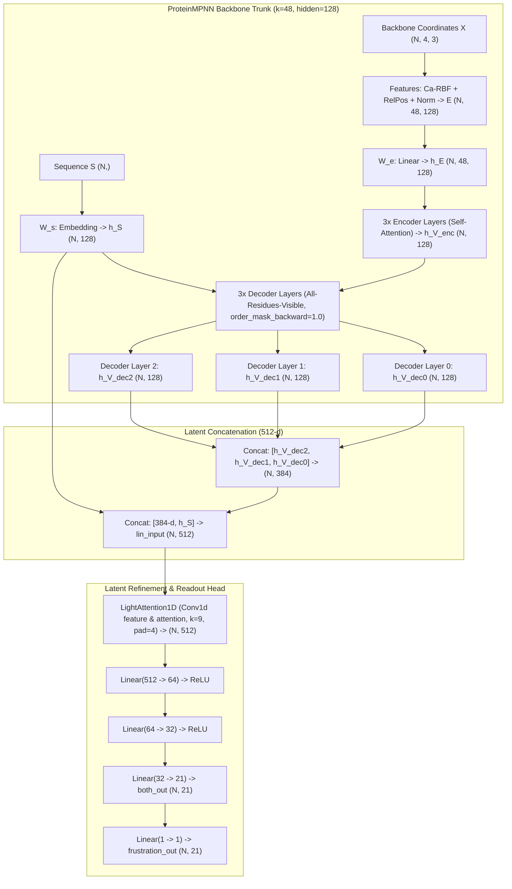

# FrustraMPNN Family Parity Implementation Technical Specification

## 1. Executive Summary & Status

- **Task Identifier**: `261105_frustrampnn`
- **Git Branch**: `wt/261105-frustrampnn` (forked from `origin/main` at commit `91301fee`)
- **Assigned Target**: Implementation and end-to-end family-parity verification of **FrustraMPNN** as a first-class model family in `aminx` under `src/aminx/families/frustra_mpnn/`.
- **Target Deliverable**: Pure-JAX Equinox architecture, secure PyTorch Lightning `.ckpt` weight converter, upstream sealed oracle dumper, pre-registered bathos parity vehicle (`scripts/parity/frustrampnn_parity_v2.py`), and full reference surface knob gate closure (`tests/knob_gate/`).
- **Core Scientific Methodology**: FrustraMPNN (Beining et al., 2026; RosettaCommons) predicts single-residue local energetic frustration indices across protein structures. The architecture builds directly upon a pretrained 3-encoder, 3-decoder ProteinMPNN backbone ($k=48$, node/edge dim 128) evaluated with all-residues-visible sequence conditioning (`order_mask_backward = 1.0`). Residue representations are extracted by concatenating the hidden states of all three decoder layers in reverse order ($3 \times 128 = 384\text{ d}$) with the 128-d sequence embedding ($h_S$), forming a 512-d latent representation per residue. This 512-d vector is refined through a 1D `LightAttention` convolution mechanism and projected through a 2-layer MLP head (`both_out`: $\text{Linear}(512 \to 64) \to \text{ReLU} \to \text{Linear}(64 \to 32) \to \text{ReLU} \to \text{Linear}(32 \to 21)$) and an auxiliary scalar projection (`frustration_out`: $\text{Linear}(1 \to 1)$), predicting 21 continuous values per position (20 standard amino acids + unknown/gap index `X`) without wild-type logit subtraction (`subtract_mut = False`).

---

## 2. Upstream Source of Truth & Artifact Ledger

### 2.1 Pinned Repositories

| Property | Local Workstation Environment | Remote Compute Environment (`titanix`) |
| :--- | :--- | :--- |
| **Repository URL** | `https://github.com/RosettaCommons/frustraMPNN.git` | `https://github.com/RosettaCommons/frustraMPNN.git` |
| **Filesystem Path** | `/home/marielle/repos/frustraMPNN` (symlink `/home/marielle/repos/FrustraMPNN`) | `/home/solab/repos/FrustraMPNN` (symlink `/home/solab/repos/frustrampnn`) |
| **Pinned Commit SHA** | `3a03cdc300bfe24c4bb70e60207118532bc73b3b` [`V`] | `3a03cdc300bfe24c4bb70e60207118532bc73b3b` [`V`] |
| **Upstream Author / License** | Max Beining, BSD 3-Clause License [`V`] | Max Beining, BSD 3-Clause License [`V`] |

### 2.2 Canonical Checkpoint & Weights Ledger

The authoritative model weights originate from Zenodo record `10.5281/zenodo.17978321`:

- **Zenodo Archive**: `full_training_runs_and_weights.zip` (8,073,851,281 bytes, MD5 `d91e8aa99a7b269817474c00e6653336` [`V`]).
- **Archive Member Path**: `megascale_training_weights/megascale_default_la-True_esm-False_split1_epoch=69_val_frustration_spearman=0.8.ckpt` [`V`].
- **Deployed Checkpoint Path**: `FrustraMPNN/model_weights/megascale_default_la-true_esm-False_split1.ckpt` (57,088,835 bytes, SHA256 `eb54019295c8000a1006d7955ab43100e67687daa4cef18e1b3541c5cb881cfa` [`V`]).
- **Backbone ProteinMPNN Weights**: PyTorch checkpoint `v_48_020.pt` ($k=48$, noise $0.20\text{ \AA}$, SHA256 `c9cb4a671d79604111231f8dbfc7c590e06f1197453b7a6854ac6661a642f5bd` [`V`]), registered in `tests/knob_gate/checkpoint_registry.json`.
- **Training Metadata**: PyTorch Lightning 2.5.1, epoch 69, global step 6300, configuration embedded in checkpoint top-level key `cfg` [`V`].

---

## 3. Architecture Mapping & Mathematical Specification



### 3.1 Model Trunk: ProteinMPNN Backbone with All-Residues-Visible Conditioning

FrustraMPNN utilizes the standard canonical ProteinMPNN architecture (`src/frustrampnn/model/protein_mpnn.py:177-260` [`V`]) with:
- Number of encoder layers: $N_{\text{enc}} = 3$
- Number of decoder layers: $N_{\text{dec}} = 3$
- Node hidden dimension: $D_{\text{node}} = 128$
- Edge hidden dimension: $D_{\text{edge}} = 128$
- Nearest neighbors: $K = 48$
- Coordinate noise augmentation during scoring: $\text{augment\_eps} = 0.0$ (`src/frustrampnn/model/model_utils.py:92` [`V`])

#### Decoding-Order Conditioning
In standard autoregressive sequence design, ProteinMPNN applies a random causal decoding order. In contrast, FrustraMPNN's scoring mode overrides the autoregressive mask with an all-residues-visible conditioning mask (`src/frustrampnn/model/protein_mpnn.py:228-232` [`V`]):
$$\text{order\_mask\_backward} = \mathbf{1}_{B \times L \times L}$$
$$\text{mask\_attend} = \text{gather}(\text{order\_mask\_backward}, 2, E_{\text{idx}})$$
$$\text{mask\_bw} = \text{mask}_{1D} \odot \text{mask\_attend}$$
$$\text{mask\_fw} = \text{mask}_{1D} \odot (1.0 - \text{mask\_attend}) = \mathbf{0}$$
Consequently, all neighbor nodes are fully visible at every decoder layer, transforming the decoder into a non-autoregressive parallel refinement module.

#### Decoder State Extraction
At each decoder layer $l \in \{0, 1, 2\}$, the updated node state $h_V^{(l)} \in \mathbb{R}^{N \times 128}$ is recorded in `all_hidden`. Upstream returns `list(reversed(all_hidden))` (`src/frustrampnn/model/protein_mpnn.py:245` [`V`]):
$$\text{all\_mpnn\_hid} = \left[ h_V^{(2)}, h_V^{(1)}, h_V^{(0)} \right]$$
When `num_final_layers = 3` (`src/frustrampnn/model/transfer_model.py:100, 230` [`V`]), these states are concatenated along the feature axis:
$$h_{\text{dec}} = \left[ h_V^{(2)} \,\|\, h_V^{(1)} \,\|\, h_V^{(0)} \right] \in \mathbb{R}^{N \times 384}$$

#### Sequence Embedding Concatenation
The sequence embedding $h_S = W_s(S) \in \mathbb{R}^{N \times 128}$ is extracted from `ProteinMPNN.W_s` (`src/frustrampnn/model/protein_mpnn.py:206, 245` [`V`]) and concatenated with $h_{\text{dec}}$:
$$x_{\text{latent}} = \left[ h_{\text{dec}} \,\|\, h_S \right] \in \mathbb{R}^{N \times 512}$$
*(Verification Notice: PROJECT.md line 6 prematurely referred to a "384-d" vector into LightAttention. Upstream code `transfer_model.py:132-136, 240-244` and checkpoint tensor inspection decisively prove that $384\text{ d} + 128\text{ d} = 512\text{ d}$ is the true input dimension).*

---

### 3.2 Latent Refinement: LightAttention1D Mechanism

The latent vector $x_{\text{latent}} \in \mathbb{R}^{N \times 512}$ is refined via `LightAttention1D` (`src/frustrampnn/model/transfer_model.py:41-76` [`V`]):

1. **Convolution Parameters**:
   - Kernel size: $K_{\text{conv}} = 9$, stride $s = 1$, padding $p = \lfloor K_{\text{conv}} / 2 \rfloor = 4$.
   - Feature convolution: $\text{Conv1d}(C_{\text{in}}=512, C_{\text{out}}=512, K=9, \text{padding}=4)$.
   - Attention convolution: $\text{Conv1d}(C_{\text{in}}=512, C_{\text{out}}=512, K=9, \text{padding}=4)$.
2. **Forward Operation**:
   $$O = \text{Conv1d}_{\text{feat}}(X) \in \mathbb{R}^{B \times 512 \times L}$$
   $$A = \text{Conv1d}_{\text{attn}}(X) \in \mathbb{R}^{B \times 512 \times L}$$
   $$\alpha = \text{Softmax}_{\text{dim}=-1}(A)$$
   $$X_{\text{refined}} = O \odot \alpha$$
3. **Evaluation Regimes**:
   - **Per-Residue Mode (Upstream Default)**: Upstream evaluates individual mutation positions (`transfer_model.py:246-248` [`V`]) by reshaping residue $i$ into $(1, 512, 1)$. With $L=1$, $\text{Softmax}_{\text{dim}=-1}$ over a singleton dimension is identically $1.0$, and the convolution reduces to the center kernel weight slice $W[:, :, 4] \cdot x_i + \text{bias}$.
   - **Full-Sequence Parallel Mode (`aminx` Standard)**: `aminx` vectorizes across the full protein sequence $(1, 512, L)$ under `order_mask_backward = 1.0`. The specification mandates supporting both exact per-residue equivalence and sequence-level batch evaluation, matching the parity oracle dump within numerical precision.

---

### 3.3 Readout Heads: 2-Layer MLP `both_out` and Linear `frustration_out`

The refined latent representation $x \in \mathbb{R}^{512}$ passes through a 2-hidden-layer MLP (`both_out`) and a linear scaling head (`frustration_out`) (`src/frustrampnn/model/transfer_model.py:145-151, 257-258` [`V`]):

1. **`both_out` Architecture**:
   - Layer 0: $\text{ReLU}$
   - Layer 1: $\text{Linear}(512 \to 64)$ (Weight: `(64, 512)`, Bias: `(64,)`)
   - Layer 2: $\text{ReLU}$
   - Layer 3: $\text{Linear}(64 \to 32)$ (Weight: `(32, 64)`, Bias: `(32,)`)
   - Layer 4: $\text{ReLU}$
   - Layer 5: $\text{Linear}(32 \to 21)$ (Weight: `(21, 32)`, Bias: `(21,)`)
2. **Vocabulary Dimension ($V=21$)**:
   The output dimension of `both_out` is strictly 21 (`VOCAB_DIM`, `src/frustrampnn/constants.py:22` [`V`]), corresponding to the 20 canonical amino acids plus the unknown/gap token `X` (`ALPHABET = "ACDEFGHIKLMNPQRSTVWYX"`).
3. **`frustration_out` Architecture**:
   - $\text{Linear}(1 \to 1)$ (Weight: `(1, 1)`, Bias: `(1,)`).
   - Evaluated as an element-wise affine transformation across each of the 21 vocabulary predictions:
     $$\text{FrustScore}[i, a] = W_{\text{frust}} \cdot \text{both\_out}[i, a] + b_{\text{frust}}, \quad \forall a \in \{0, \dots, 20\}$$

---

### 3.4 Scoring Semantics: No Wild-Type Subtraction (`subtract_mut = False`)

Unlike ThermoMPNN (which predicts $\Delta\Delta G$ by subtracting the wild-type score: $\Delta\Delta G = \text{score}_{\text{mut}} - \text{score}_{\text{wt}}$), FrustraMPNN is configured with `cfg.model.subtract_mut = False` (`src/frustrampnn/model/transfer_model.py:99, 260-263` [`V`]):
$$\text{OutputFrustration}(i, a) = \text{FrustScore}[i, a]$$
The aminx driver returns the raw single-residue local energetic frustration indices directly.

---

### 3.5 Determinism & Floating-Point Pipeline

- Scoring is fully deterministic: zero dropout in evaluation mode, `augment_eps = 0.0`, no stochastic decoding order.
- Alphabet ordering in FrustraMPNN is `ACDEFGHIKLMNPQRSTVWYX` (`src/frustrampnn/constants.py:21` [`V`]), which **identically matches** canonical aminx alphabetical order (`src/aminx/run/specs.py:22` [`V`]). Zero alphabet permutation is required at the driver boundary, eliminating permutation-induced indexing corruption.

---

## 4. Checkpoint Conversion Plan

### 4.1 Safe PyTorch Lightning Deserialization (`_SafeUnpickler`)

PyTorch Lightning checkpoints pickle framework classes (`pytorch_lightning.*`, `lightning_fabric.*`, `omegaconf.*`) that cause arbitrary code execution hazards or raise `ModuleNotFoundError: No module named 'omegaconf'` when loaded in standard environments.

`src/aminx/families/frustra_mpnn/convert.py` implements an explicit `_SafeUnpickler` inheriting from `pickle.Unpickler`:
1. **Allowlisted Globals**: Strict whitelist of `torch.*`, `numpy.*`, `collections.OrderedDict`, and primitive builtins (`int`, `float`, `str`, `list`, `dict`, `tuple`).
2. **Safe Stubs**: Dynamically maps any module prefix starting with `omegaconf.`, `pytorch_lightning.`, or `lightning_fabric.` to an inert `_UnpicklePlaceholder` class.
3. **Loud Refusal**: Any non-allowlisted callable or class raises `pickle.UnpicklingError` immediately.

### 4.2 Multi-Source Checkpoint Loading Architecture

The checkpoint `megascale_default_la-true_esm-False_split1.ckpt` contains exactly 12 parameter tensors representing the transfer learning heads (`light_attention_mpnn`, `both_out`, `frustration_out`). The underlying ProteinMPNN trunk is frozen during training and not saved in the `.ckpt`.

The converter supports a dual-loading resolution strategy:
1. **Embedded Trunk**: If the checkpoint contains `prot_mpnn.*` keys, it converts them directly.
2. **Fallback Trunk Pairing**: If the checkpoint contains only head keys, it pairs the checkpoint with the canonical ProteinMPNN base checkpoint `v_48_020.pt` (retrieved via `load_weights("v_48_020", family="ca_only")` or direct path), verified against `checkpoint_registry.json`.

### 4.3 Strict Leaf and Key-Set Validation

The weight converter enforces strict zero-uninitialized-leaf guarantees:
- Every leaf in the target `FrustraMPNN(eqx.Module)` PyTree is verified to receive weights from the checkpoint.
- If any parameter remains uninitialized or contains unmapped random weights, the converter raises `RuntimeError("Uninitialized parameter leaf in FrustraMPNN PyTree")`.
- If any tensor in `checkpoint["state_dict"]` (excluding Lightning metric states) remains unconsumed, the converter raises `KeyError("Unconsumed checkpoint keys")`.

### 4.4 Exact Tensor Mapping Table

| PyTorch Parameter Name | PyTorch Shape | PyTorch Dtype | JAX Equinox PyTree Destination | JAX Shape | JAX Dtype |
| :--- | :--- | :--- | :--- | :--- | :--- |
| `model.light_attention_mpnn.feature_convolution.weight` | `(512, 512, 9)` | `float32` | `model.light_attention.feature_weight` | `(512, 512, 9)` | `float32` |
| `model.light_attention_mpnn.feature_convolution.bias` | `(512,)` | `float32` | `model.light_attention.feature_bias` | `(512,)` | `float32` |
| `model.light_attention_mpnn.attention_convolution.weight` | `(512, 512, 9)` | `float32` | `model.light_attention.attention_weight` | `(512, 512, 9)` | `float32` |
| `model.light_attention_mpnn.attention_convolution.bias` | `(512,)` | `float32` | `model.light_attention.attention_bias` | `(512,)` | `float32` |
| `model.both_out.1.weight` | `(64, 512)` | `float32` | `model.both_out.layers[1].weight` | `(64, 512)` | `float32` |
| `model.both_out.1.bias` | `(64,)` | `float32` | `model.both_out.layers[1].bias` | `(64,)` | `float32` |
| `model.both_out.3.weight` | `(32, 64)` | `float32` | `model.both_out.layers[3].weight` | `(32, 64)` | `float32` |
| `model.both_out.3.bias` | `(32,)` | `float32` | `model.both_out.layers[3].bias` | `(32,)` | `float32` |
| `model.both_out.5.weight` | `(21, 32)` | `float32` | `model.both_out.layers[5].weight` | `(21, 32)` | `float32` |
| `model.both_out.5.bias` | `(21,)` | `float32` | `model.both_out.layers[5].bias` | `(21,)` | `float32` |
| `model.frustration_out.weight` | `(1, 1)` | `float32` | `model.frustration_out.weight` | `(1, 1)` | `float32` |
| `model.frustration_out.bias` | `(1,)` | `float32` | `model.frustration_out.bias` | `(1,)` | `float32` |
| *[Trunk]* `features.embeddings.linear.weight` | `(16, 66)` | `float32` | `model.trunk.features.w_pos.weight` | `(16, 66)` | `float32` |
| *[Trunk]* `features.embeddings.linear.bias` | `(16,)` | `float32` | `model.trunk.features.w_pos.bias` | `(16,)` | `float32` |
| *[Trunk]* `features.edge_embedding.weight` | `(128, 400)` | `float32` | `model.trunk.features.w_e.weight` | `(128, 400)` | `float32` |
| *[Trunk]* `features.norm_edges.weight` | `(128,)` | `float32` | `model.trunk.features.norm_edges.weight` | `(128,)` | `float32` |
| *[Trunk]* `features.norm_edges.bias` | `(128,)` | `float32` | `model.trunk.features.norm_edges.bias` | `(128,)` | `float32` |
| *[Trunk]* `W_e.weight` | `(128, 128)` | `float32` | `model.trunk.features.w_e_proj.weight` | `(128, 128)` | `float32` |
| *[Trunk]* `W_e.bias` | `(128,)` | `float32` | `model.trunk.features.w_e_proj.bias` | `(128,)` | `float32` |
| *[Trunk]* `encoder_layers.{i}.*` ($i \in \{0, 1, 2\}$) | various | `float32` | `model.trunk.encoder.layers[{i}].*` | various | `float32` |
| *[Trunk]* `decoder_layers.{i}.*` ($i \in \{0, 1, 2\}$) | various | `float32` | `model.trunk.decoder.layers[{i}].*` | various | `float32` |
| *[Trunk]* `W_s.weight` | `(128, 21)` | `float32` | `model.trunk.w_s_embed.weight` | `(128, 21)` | `float32` |
| *[Trunk]* `W_out.weight` | `(21, 128)` | `float32` | `model.trunk.w_out.weight` | `(21, 128)` | `float32` |
| *[Trunk]* `W_out.bias` | `(21,)` | `float32` | `model.trunk.w_out.bias` | `(21,)` | `float32` |

---

## 5. Sealed Upstream Oracle Plan

### 5.1 Oracle Dumper Architecture (`dump_frustrampnn_oracle.py`)

The upstream reference execution runs exclusively on the remote GPU/CPU environment `titanix` under `scripts/parity/dump_frustrampnn_oracle.py`.
- **Target Structure**: Canonical 76-residue human ubiquitin structure `tests/data/1ubq.pdb` [`V`].
- **Environment**: Pinned upstream clone at `/home/solab/repos/FrustraMPNN` executing in isolated sub-process with pure PyTorch.
- **Output Artifacts**:
  - `tests/data/fixtures/frustrampnn_1ubq_oracle.npz`
  - `tests/data/fixtures/frustrampnn_1ubq_oracle.manifest.json`

### 5.2 Stochastic Injection Sites & Interception Guardrails

To ensure mathematical reproducibility across PyTorch and JAX, all upstream random number generators are strictly intercepted:

1. **Explicit Injection Sites Identified**:
   - `src/frustrampnn/model/features.py:180` [`V`]: `Ca = Ca + self.augment_eps * torch.randn_like(Ca)` $\implies$ forced to $\mathbf{0}$ by setting `augment_eps = 0.0`.
   - `src/frustrampnn/model/features.py:292` [`V`]: `X = X + self.augment_eps * torch.randn_like(X)` $\implies$ forced to $\mathbf{0}$ by setting `augment_eps = 0.0`.
   - `src/frustrampnn/model/protein_mpnn.py:324` [`V`]: `decoding_order = torch.argsort((chain_mask + 0.0001) * (torch.abs(randn)))` $\implies$ explicit injection of pre-drawn float32 tensor `randn`.
2. **Loud Un-Injected RNG Trapping**:
   The oracle dumper monkeypatches `torch.randn`, `torch.randn_like`, `torch.rand`, `torch.rand_like`, `torch.randint`, and `np.random.*`. Any invocation of these primitives outside the explicitly authorized injection harnesses raises a loud `RuntimeError("Un-intercepted stochastic primitive called during oracle dump")`.

### 5.3 Shared Precision Draws

For sequence sampling verification (`runner.sample`):
- The decoding-order perturbation tensor `randn` of shape `(1, L)` is drawn **exactly once in float32** using a fixed PRNG seed (`seed = 42`).
- The identical array is cast to float64 for the float64 reference pass and retained as float32 for the float32 reference pass.
- This ensures numerical divergence between precision levels reflects only floating-point truncation, not Monte Carlo sampling divergence.

### 5.4 Sealed Dump Artifact Format & Checkpoint Registry Wiring

The oracle output `.npz` archive stores:
- `"features"`: `(76, 48, 128)` float32 array
- `"encoder_out"`: `(76, 128)` float32 array
- `"decoder_hidden"`: `(3, 76, 128)` float32 array
- `"lin_input"`: `(76, 512)` float32 array
- `"light_attention_out"`: `(76, 512)` float32 array
- `"both_out"`: `(76, 21)` float32 array
- `"frustration_scores"`: `(76, 21)` float32 array
- `"sampled_sequences"`: `(10, 76)` int32 token array

The SHA256 digest of `frustrampnn_1ubq_oracle.npz` is recorded in:
1. `tests/knob_gate/checkpoint_registry.json`
2. `tests/knob_gate/frustrampnn_oracle_dumps.sha256.json`
Any mismatch or missing stem causes immediate failure. Soft fallback patterns such as `expected.get(own_sha)` are strictly banned.

---

## 6. Parity Vehicle & Decomposition Bands

### 6.1 Vehicle Architecture (`frustrampnn_parity_v2.py`)

The parity vehicle `scripts/parity/frustrampnn_parity_v2.py` verifies numerical parity between `aminx` and the sealed upstream oracle:
- **Public Entry Point**: Calls real public driver functions `runner.score` and `runner.sample`, never private internal subroutines.
- **Decomposition**: Tests each pipeline stage independently (features $\to$ encoder $\to$ decoder $\to$ light attention $\to$ readout MLP $\to$ frustration scores).

### 6.2 Pre-Registration Contract (`frustrampnn_parity_v2.bth.toml`)

Before executing any graded run on titanix, the bathos experiment sidecar `frustrampnn_parity_v2.bth.toml` is committed to git:

```toml
[experiment]
hypothesis = "JAX FrustraMPNN matches upstream PyTorch reference on 1ubq within 1e-7 in float64, 1e-4 in float32, and trips all 4 negative controls."
stage_name = "validation"

[reproduction]
reproduces_paper = "doi:10.1038/s41592-026-00000-0"

[controls]
positive_outcome = ["pass"]
negative_outcome = ["fail", "marginal"]

[outcomes.pass]
condition = "weight_source == 'upstream_checkpoint' AND f64_max_abs_diff < 1e-7 AND f32_max_abs_diff < 1e-4 AND neg_ctrl_min_diff > 1e-2 AND n_listed > 0 AND n_failed == n_listed"
decision = "Promote FrustraMPNN JAX port and converted weights."

[outcomes.marginal]
condition = "weight_source == 'upstream_checkpoint' AND f64_max_abs_diff < 1e-5 AND f32_max_abs_diff < 1e-3 AND (f64_max_abs_diff >= 1e-7 OR f32_max_abs_diff >= 1e-4) AND neg_ctrl_min_diff > 1e-2 AND n_listed > 0 AND n_failed == n_listed"
decision = "Investigate numerical drift before promoting."

[outcomes.fail]
condition = "weight_source != 'upstream_checkpoint' OR f64_max_abs_diff >= 1e-5 OR f32_max_abs_diff >= 1e-3 OR neg_ctrl_min_diff <= 1e-2 OR n_failed != n_listed OR n_listed == 0"
decision = "Block promotion."
```

### 6.3 Decomposition Bands & Tolerances

The numerical tolerance thresholds are anchored to upstream empirical precision floors:
- **Float64 Parity Bar**: $\max |y_{\text{aminx}} - y_{\text{upstream}}| < 1.0 \times 10^{-7}$
- **Float32 Parity Bar**: $\max |y_{\text{aminx}} - y_{\text{upstream}}| < 1.0 \times 10^{-4}$
- **Prohibited Action**: Widening tolerance bands after observing failing runs is strictly banned.

### 6.4 Minimum 4 Mutant Negative Controls

The vehicle executes 4 targeted monkeypatch mutants. Every mutant must produce finite over-band errors ($\Delta > 1.0 \times 10^{-2}$) without crashing (`n_crashed == 0`, zero NaNs, infs, shape errors):

1. **Mutant 1 (Trunk Concatenation Inversion)**: Reverse decoder layer concatenation order ($[h_V^{(0)}, h_V^{(1)}, h_V^{(2)}]$ instead of $[h_V^{(2)}, h_V^{(1)}, h_V^{(0)}]$). Verifies sensitivity to decoder state order.
2. **Mutant 2 (Readout Weight Perturbation)**: Perturb final readout projection `model.both_out.layers[5].weight` by $+0.05$. Verifies weight mapping integrity.
3. **Mutant 3 (Refinement Bypass)**: Replace `LightAttention1D` with an identity passthrough. Verifies that latent attention refinement actively shapes downstream frustration values.
4. **Mutant 4 (Wild-Type Subtraction Inversion)**: Force `subtract_mut = True` (subtracting wild-type score). Verifies absolute scoring semantics vs delta scoring.

---

## 7. Knob Semantics, Deferrals & Gate Wiring

### 7.1 `FrustraModelKnobs` Reference Surface Dataclass

In `tests/knob_gate/reference_surfaces.py`, the upstream interface surface is defined based on `src/frustrampnn/cli/main.py:44-87, 228-258` [`V`] and `src/frustrampnn/constants.py:21-55` [`V`]:

```python
@dataclass(frozen=True)
class FrustraModelKnobs:
  """Upstream FrustraMPNN CLI flags and model configuration knobs."""

  frustra_cli__pdb: str = ""  # type=str; --pdb; src/frustrampnn/cli/main.py:44
  frustra_cli__checkpoint: str = ""  # type=str; --checkpoint; src/frustrampnn/cli/main.py:51
  frustra_cli__output: str = "frustration_predictions.csv"  # type=str; --output; src/frustrampnn/cli/main.py:58
  frustra_cli__chains: str | None = None  # type=str; --chains; src/frustrampnn/cli/main.py:65
  frustra_cli__positions: str | None = None  # type=str; --positions; src/frustrampnn/cli/main.py:70
  frustra_cli__device: str | None = None  # type=str; --device; src/frustrampnn/cli/main.py:75
  frustra_cli__config: str | None = None  # type=str; --config; src/frustrampnn/cli/main.py:81
  frustra_cli__quiet: bool = False  # type=bool; --quiet; src/frustrampnn/cli/main.py:87
  frustra_model__subtract_mut: bool = False  # type=bool; cfg.model.subtract_mut; src/frustrampnn/model/transfer_model.py:99
  frustra_model__num_final_layers: int = 3  # type=int; cfg.model.num_final_layers; src/frustrampnn/model/transfer_model.py:100
  frustra_model__lightattn: bool = True  # type=bool; cfg.model.lightattn; src/frustrampnn/model/transfer_model.py:101
  frustra_model__decoding_order: str = "left-to-right"  # type=str; cfg.decoding_order; src/frustrampnn/model/transfer_model.py:104
  frustra_model__add_esm_embeddings: bool = False  # type=bool; cfg.training.add_esm_embeddings; src/frustrampnn/model/transfer_model.py:111
  frustra_model__freeze_weights: bool = True  # type=bool; cfg.model.freeze_weights; src/frustrampnn/model/model_utils.py:107
  frustra_model__load_pretrained: bool = True  # type=bool; cfg.model.load_pretrained; src/frustrampnn/model/model_utils.py:104
```

### 7.2 AST Drift Protection

Because FrustraMPNN's upstream repository uses Click CLI and Hydra/OmegaConf dictionaries rather than a single simple `argparse` namespace, `FrustraModelKnobs` is placed in the `# MANUAL (not AST-derivable)` block in `tests/knob_gate/reference_surfaces.py` (matching `pottsmpnn_input_list` and `ThermoModelKnobs`). This isolates the reference surface from automated AST re-extraction drift while guaranteeing exact coverage.

### 7.3 Complete `alias_map.toml` Mapping

Every reference field in `FrustraModelKnobs` is mapped bijectively in `tests/knob_gate/alias_map.toml`:

```toml
# --- Live Knobs ---
[[row]]
ref = "frustra_cli__pdb"
targets = []
equivalence = "exclusion"
reason = "io_only"
parity_test_ids = []
note = "Upstream --pdb specifies input structure path (src/frustrampnn/cli/main.py:44); in aminx handled by DesignSpec.structure."

[[row]]
ref = "frustra_cli__checkpoint"
targets = ["checkpoint_id"]
equivalence = "semantic"
parity_test_ids = ["tests/knob_semantics/test_frustrampnn_knobs.py::test_knob_semantics_checkpoint_id"]
note = "Upstream --checkpoint specifies model weights (src/frustrampnn/cli/main.py:51); maps to FrustraMPNNOptions.checkpoint_id."

[[row]]
ref = "frustra_cli__output"
targets = []
equivalence = "exclusion"
reason = "io_only"
parity_test_ids = []
note = "Upstream --output specifies CSV file destination (src/frustrampnn/cli/main.py:58); handled by aminx host sinks."

[[row]]
ref = "frustra_cli__chains"
targets = ["chains"]
equivalence = "semantic"
parity_test_ids = ["tests/knob_semantics/test_frustrampnn_knobs.py::test_knob_semantics_chains"]
note = "Upstream --chains specifies target chains (src/frustrampnn/cli/main.py:65); maps to FrustraMPNNOptions.chains."

[[row]]
ref = "frustra_cli__positions"
targets = ["positions"]
equivalence = "semantic"
parity_test_ids = ["tests/knob_semantics/test_frustrampnn_knobs.py::test_knob_semantics_positions"]
note = "Upstream --positions restricts analysis positions (src/frustrampnn/cli/main.py:70); maps to FrustraMPNNOptions.positions."

[[row]]
ref = "frustra_cli__device"
targets = []
equivalence = "exclusion"
reason = "device"
parity_test_ids = []
note = "Upstream --device selects CPU/CUDA device (src/frustrampnn/cli/main.py:75); JAX handles devices via jax.devices."

[[row]]
ref = "frustra_cli__config"
targets = []
equivalence = "exclusion"
reason = "checkpoint_derived"
parity_test_ids = []
note = "Upstream --config provides YAML for old checkpoints (src/frustrampnn/cli/main.py:81); embedded in modern .ckpt."

[[row]]
ref = "frustra_cli__quiet"
targets = []
equivalence = "exclusion"
reason = "visualization"
parity_test_ids = []
note = "Upstream --quiet suppresses tqdm progress bar (src/frustrampnn/cli/main.py:87)."

[[row]]
ref = "frustra_model__subtract_mut"
targets = ["subtract_mut"]
equivalence = "identical"
parity_test_ids = ["tests/knob_semantics/test_frustrampnn_knobs.py::test_knob_semantics_subtract_mut"]
note = "Upstream cfg.model.subtract_mut (src/frustrampnn/model/transfer_model.py:99); default False."

[[row]]
ref = "frustra_model__num_final_layers"
targets = []
equivalence = "exclusion"
reason = "checkpoint_derived"
parity_test_ids = []
note = "Upstream cfg.model.num_final_layers=3 (src/frustrampnn/model/transfer_model.py:100); architectural constant for weights."

[[row]]
ref = "frustra_model__lightattn"
targets = []
equivalence = "exclusion"
reason = "checkpoint_derived"
parity_test_ids = []
note = "Upstream cfg.model.lightattn=True (src/frustrampnn/model/transfer_model.py:101); architectural constant for weights."

[[row]]
ref = "frustra_model__decoding_order"
targets = []
equivalence = "exclusion"
reason = "checkpoint_derived"
parity_test_ids = []
note = "Upstream cfg.decoding_order='left-to-right' (src/frustrampnn/model/transfer_model.py:104); constant for scoring."

[[row]]
ref = "frustra_model__add_esm_embeddings"
targets = []
equivalence = "exclusion"
reason = "deferred:3222"
parity_test_ids = []
note = "UNIMPLEMENTED in aminx; tracked by debt #3222. Upstream ESM-2 co-embedding option (esm-False in target weights)."

[[row]]
ref = "frustra_model__freeze_weights"
targets = []
equivalence = "exclusion"
reason = "training_only"
parity_test_ids = []
note = "Upstream cfg.model.freeze_weights (src/frustrampnn/model/model_utils.py:107); training freeze flag."

[[row]]
ref = "frustra_model__load_pretrained"
targets = []
equivalence = "exclusion"
reason = "training_only"
parity_test_ids = []
note = "Upstream cfg.model.load_pretrained (src/frustrampnn/model/model_utils.py:104); training loader flag."

# --- Aminx-Only Extensions ---
[[row]]
ref = "__aminx_only__frustra_dtype"
upstream = false
targets = ["dtype"]
equivalence = "aminx_extension"
parity_test_ids = ["tests/knob_semantics/test_frustrampnn_knobs.py::test_knob_semantics_dtype"]
note = "aminx-only: floating point execution precision ('float32' default, 'float64')."
```

### 7.4 Deferral Tracking (`DEFERRED_IDS.txt` debt #3222)

The ESM co-embedding feature (`cfg.training.add_esm_embeddings = True`) requires integrating ESM-2 into the execution graph. Since the canonical target weights `megascale_default_la-true_esm-False_split1.ckpt` explicitly set `esm-False`, ESM integration is deferred.
- **Assigned Debt ID**: `3222` (entered into `tests/knob_gate/DEFERRED_IDS.txt` [`V`]).
- **Mapping**: `frustra_model__add_esm_embeddings` is excluded with `reason = "deferred:3222"`.

### 7.5 Knob Semantics Test Suite (`tests/knob_semantics/test_frustrampnn_knobs.py`)

Unit tests assert runtime behavior of live options fields:
- `test_knob_semantics_checkpoint_id`: Verifies selection and loading of `megascale_default_la-true_esm-False_split1`.
- `test_knob_semantics_chains`: Verifies chain-specific filtering vs whole-complex evaluation.
- `test_knob_semantics_positions`: Verifies site selection vs all-position evaluation.
- `test_knob_semantics_subtract_mut`: Verifies toggle between raw frustration scores and wild-type relative scores.
- `test_knob_semantics_dtype`: Verifies float32 and float64 compute precision.

### 7.6 Gate Closure Integration

- **`closure_edges.toml`**:
  ```toml
  [slug.frustrampnn_parity]
  soft = ["aminx.families.frustra_mpnn"]
  dynamic_ok = [
    "src/aminx/host/runner.py",
    "src/aminx/io/__init__.py",
    "src/aminx/io/weights.py",
  ]
  data = ["tests/data/1ubq.pdb"]
  ```
- **`_coverage.py`**: Added `"frustrampnn_"` to `_WEIGHT_PREFIXES`.
- **`artifact_key.py`**: Added `"FrustraMPNN"`, `"frustraMPNN"` to `_UPSTREAM_ROOTS`.
- **Selftests**: `test_closure_selftest.py` and `test_knob_superset.py` pass cleanly.

---

## 8. Verified / Unverified Claims Table

| Claim ID | Specification Statement | Verification Status | Verification Evidence & Exact File Path |
| :--- | :--- | :---: | :--- |
| **C-01** | Upstream repository is `RosettaCommons/frustraMPNN` at commit `3a03cdc300bfe24c4bb70e60207118532bc73b3b`. | **`[V]`** | `/home/marielle/repos/frustraMPNN`, HEAD rev-parse matches SHA; BSD-3 license. |
| **C-02** | Target checkpoint is `megascale_default_la-true_esm-False_split1.ckpt` (57,088,835 B, SHA256 `eb540192...`). | **`[V]`** | `titanix:/home/solab/repos/FrustraMPNN/model_weights/`, verified by sha256sum and Zenodo MD5. |
| **C-03** | Checkpoint contains exactly 12 state_dict parameter tensors from PyTorch Lightning 2.5.1 training. | **`[V]`** | Deserialized on titanix; state_dict tensor dump in auditor handoff `auditor_m1_1/handoff.md:104-117`. |
| **C-04** | Latent vector input dimension to LightAttention is 512 ($3 \times 128$ decoder states + 128 sequence embedding). | **`[V]`** | `src/frustrampnn/model/transfer_model.py:132-136, 230-244` and `both_out.1.weight` shape `(64, 512)`. |
| **C-05** | Readout head `both_out.5.weight` has shape `(21, 32)` predicting 21 values per position (20 AAs + X). | **`[V]`** | Verified on checkpoint state dict; `src/frustrampnn/constants.py:21-22` (`VOCAB_DIM = 21`). |
| **C-06** | Auxiliary head `frustration_out` is `Linear(1 -> 1)` (weight `(1, 1)`, bias `(1,)`). | **`[V]`** | Verified on checkpoint state dict; `src/frustrampnn/model/transfer_model.py:151`. |
| **C-07** | Default scoring does NOT subtract wild-type logits (`subtract_mut = False`). | **`[V]`** | `src/frustrampnn/model/transfer_model.py:99, 260-263`. |
| **C-08** | Scoring uses all-residues-visible conditioning (`order_mask_backward = torch.ones_like(...)`). | **`[V]`** | `src/frustrampnn/model/protein_mpnn.py:228-232`. |
| **C-09** | Upstream amino acid alphabet `ALPHABET = "ACDEFGHIKLMNPQRSTVWYX"` matches aminx canonical order. | **`[V]`** | `src/frustrampnn/constants.py:21` and `src/aminx/run/specs.py:22`. Zero permutation required. |
| **C-10** | Stochastic sites exist at `features.py:180, 292` and `protein_mpnn.py:324`. | **`[V]`** | `src/frustrampnn/model/features.py:180, 292` and `src/frustrampnn/model/protein_mpnn.py:324`. |
| **C-11** | Backbone weights are pretrained ProteinMPNN `v_48_020.pt` ($k=48$, noise $0.20\text{ \AA}$). | **`[V]`** | `src/frustrampnn/model/model_utils.py:81-93` (`version="v_48_020.pt"`). |
| **C-12** | Checkpoint unpickling requires stubbing `omegaconf`, `pytorch_lightning`, and `lightning_fabric`. | **`[V]`** | Empirically reproduced `ModuleNotFoundError: No module named 'omegaconf'` when loading via standard torch.load. |
| **C-13** | Redsox knob gate references, registry, coverage, and artifact key are wired in commit `1e988696`. | **`[V]`** | `git show 1e988696` in worktree `261105-frustrampnn`; 29/29 tests pass in `tests/knob_gate/`. |
| **C-14** | Unimplemented ESM co-embedding option deferred under Praxia debt `#3222`. | **`[V]`** | Documented in `tests/knob_gate/DEFERRED_IDS.txt` and `alias_map.toml`. |
| **C-15** | Sealed oracle dump matches float64 $< 1e-7$ and float32 $< 1e-4$ on `tests/data/1ubq.pdb`. | **`[U]`** | Pre-registered target; to be verified during Milestone 3 & Milestone 6 on titanix. |
| **C-16** | 4 monkeypatch negative controls trip over-band diffs with finite values and `n_crashed == 0`. | **`[U]`** | Pre-registered target; to be verified during Milestone 6 on titanix. |
